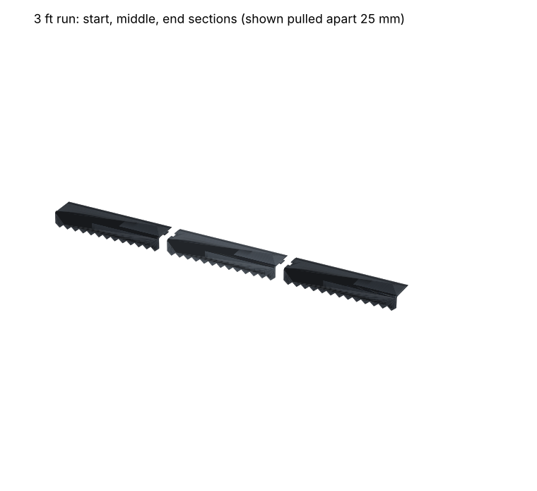
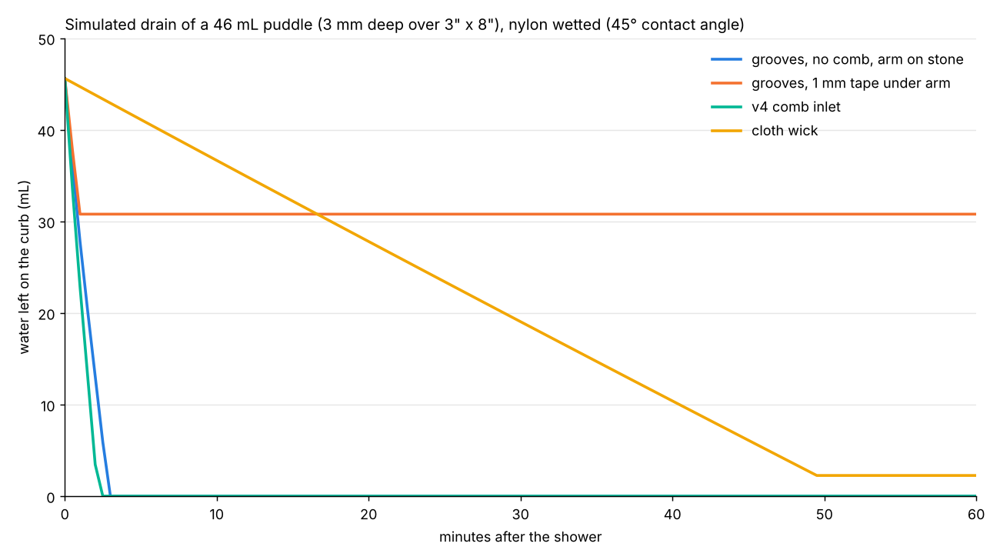

# Curb drain clip

A low-profile, 3D-printed clip that drains water off a flat granite shower entry curb. Water runs down the fixed glass panel and pools on the curb against the silicone bead. The clip carries that water over the curb's shower-side edge and drips it onto the tile. It has no moving parts and needs no power: capillary grooves and gravity do the work.



Infographic with every cross-section, drawn to scale: [`docs/curb-drain-sections.html`](docs/curb-drain-sections.html)

## How it works

| Part | What it does |
|---|---|
| **Comb inlet** | The last 8 mm of the arm, next to the silicone bead. Slots cut through to the stone, so even a 0.6 mm film of water gets in. |
| **Grooved arm** | 2.6 mm thick and 59 mm long, resting directly on the granite. V-grooves 1.0 mm wide and 1.3 mm deep at a 2.0 mm pitch pull water toward the edge by capillary action. |
| **Bend and leg** | Wrap over the curb's shower-side edge and run 32 mm down the front of the ¾ in (19 mm) slab, ending 13 mm below its ½ in overhang and well clear of the floor 1¾ in below. Gravity on the leg pulls water through the grooves; any leg from about 25 mm up gives the same flow, because the grooves' capillary pull is the limit. |
| **Drip tips** | A V point (or a sawtooth every 24 mm on the long run) so drops fall cleanly onto the tile. |

## Files

| Path | Contents |
|---|---|
| `stl/single-clip/curb_drain_grooves.stl` | One 30 mm clip, fabric-free capillary grooves (v4) |
| `stl/single-clip/curb_drain_wick.stl` | One 30 mm clip that holds a 12 mm microfiber strip instead |
| `stl/3ft-run/curb_run_{start,middle,end}.stl` | 914 mm (3 ft) run in three 304.8 mm sections joined by drop-in dovetails |
| `cad/curb_drain.scad` | Parametric OpenSCAD source for the single clip (`mode = "grooves"` or `"wick"`) |
| `cad/curb_run.py` | Generator for the long run in sections (Python + manifold3d) |
| `sim/` | Capillary flow simulation: groove cross-section solver, drain model, design comparison |
| `docs/` | Infographic, its generator, and preview images |

## Fitting it to your curb

These values are set for the measured curb: a ¾ in (19 mm) granite slab that overhangs the shower by about ½ in, 1¾ in above the shower floor, with the fixed glass 2⅝ in (67 mm) from the shower-side edge:

- `pad_depth = 59`: arm length. It ends 7.7 mm short of the glass, which leaves a 2.9 mm gap to the 3/16 in (4.8 mm) silicone bead at its base. Keep that gap at 2–3 mm so the strip never touches the silicone.
- `edge_radius = 3`: the curb's inner top edge (0.5 = sharp, ~19 = full bullnose).
- `drop = 32`: how far the leg runs down the slab's front edge. Set it to the slab thickness plus about 13 mm so every drip point is below the overhang.

Regenerate:

```
openscad -D 'mode="grooves"' -o curb_drain_grooves.stl cad/curb_drain.scad
openscad -D 'mode="wick"'    -o curb_drain_wick.stl    cad/curb_drain.scad
pip install manifold3d trimesh
cd stl/3ft-run && python3 ../../cad/curb_run.py 914.4      # total length in mm; optional 2nd arg = max section (default 350)
```

`curb_run.py` keeps its own copy of the profile settings at the top of the file. If you change the `.scad`, change those too.

## Ordering from JLC3DP

- **Material:** MJF PA12-HP nylon, dyed black if offered (the curb is black granite). Units: mm.
- **Checked against JLC's MJF guidelines:** 1.0 mm minimum walls (ridges, comb teeth, leading edge), 1.0 mm slots (≥ 0.6 mm), no closed cavities, 0.3 mm dovetail clearance (0.2–0.4 mm for parts that fit together), and every part well inside 370 × 276 × 360 mm.
- **Accuracy is ±0.3 mm or 0.4%,** so each 305 mm section can be about 1.2 mm long or short. Leave a few mm at the ends of the run.
- **The V-groove bottoms are finer than JLC's 0.8 mm minimum for engraved detail,** so they will print rounded. The simulation still drains fully with a 0.4 mm bottom radius, just more slowly (about 4 min instead of 2.5).
- **The comb teeth are 1.0 × ~1.5 mm ribs.** If JLC's upload check flags them, set `comb_len = 5`.

## Installing

1. **Wash the clip with dish soap before use.** As-printed nylon can bead water, which slows it a lot (14–90 min instead of 2–4). Soap from showering keeps it working.
2. **Tape the vertical leg only** (wet-rated double-sided tape such as 3M VHB) to the slab's front edge. **Never put tape under the arm:** 1 mm of tape lifts the grooves above the puddle and the clip stalls with most of the water left.
3. The arm rests directly on the granite, with the comb end toward the glass. On the long run, drop each section onto the previous one's dovetail from above.

## Simulation summary

The model solves Stokes flow on each groove cross-section (checked against exact pipe solutions to 0.3%). It then couples that to capillary and gravity flow along the arm, bend and leg, and to a model of a pinned puddle draining away. Reference puddle: 46 mL, 3 mm deep over 3 × 8 in.



| Design (nylon wetted) | Result |
|---|---|
| v4 comb inlet | about 2–4 min, puddle fully drained in every case run (14–90 min before the first soap wash) |
| Grooves without the comb | 2–4 min, but stalls with about 20 mL left if the granite holds the puddle edge tightly |
| Grooves with 1 mm tape under the arm | stalls with 33–37 mL left |
| Cloth wick | about 50 min, leaves a damp film |

The contact angles on the nylon and the granite were not measured, so the results cover a range. The model also assumes the shrinking puddle stays in touch with the clip. The 3 ft run makes sure it does.

Reproduce: `cd sim && python3 compare.py && python3 plot_curves.py`. This needs numpy, scipy and matplotlib.
