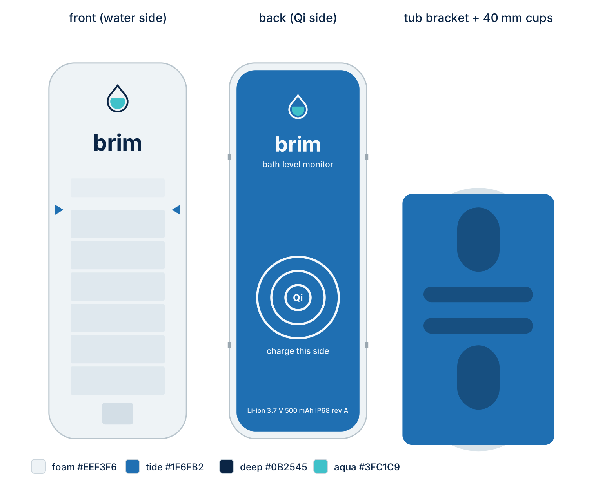
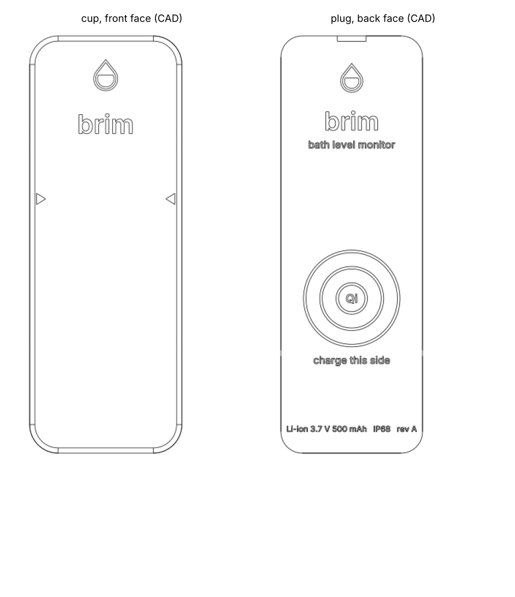

# Branding and industrial design (rev A)

**brim**: *bath level monitor*. "Alert before it brims."
The name is a working name. It's set in one place (`NAME` in `hardware/mech/brand.py`), and every
asset and the CAD regenerate from it. Do a trademark search before using it publicly.

## The mark
A water drop whose **lower part is filled up to a level line**: the product in one picture
(water rising to a set level). It's drawn from the same geometry in the docs (`brand_logo.svg`) and on
the device (debossed). It reads at 8–9 mm on the enclosure and at favicon size.

## Palette
| Name | Hex | Use |
|---|---|---|
| foam | `#EEF3F6` | Cup (frosted / natural translucent white). Calm and bathroom-neutral, and the LED glows through it |
| tide | `#1F6FB2` | Plug, bracket, alarm chevrons. Tells you which side goes on the charger |
| deep | `#0B2545` | Wordmark, icons, text |
| aqua | `#3FC1C9` | The water in the mark, highlights, LED colour if a colour LED is ever used |

## Typography
**Inter** (SIL Open Font License): SemiBold for the wordmark (lowercase), Medium for small text.
The smallest debossed text is 2.2 mm (rating line), which is legible from SLA and MJF prints.

## Design features on the enclosure (all debossed 0.35 mm, no paint or glue needed)

| Where | Feature | Why |
|---|---|---|
| Front, dry top band | Mark + "brim" wordmark | Branding where the water never reaches. Over the electronics, **not** over the electrodes |
| Front, both edges | **Alarm-level chevrons** pointing at the top of pad 6 | Shows where the alarm triggers, which helps when positioning the bracket on the tub. They sit on the margins outside the electrodes and are drawn sideways so water drains out |
| Front, electrode band | **Nothing.** A flat, even 1.2 mm wall | Any relief there would thin the wall unevenly and trap water films (see the electrode study) |
| Back (Qi face) | Mark, wordmark, "bath level monitor" | Product identity |
| Back | **Qi target**: three rings centred on the coil, plus "charge this side" | Tells you where to put the charger. The deboss also makes the wall 0.35 mm thinner over the coil, which slightly helps coupling |
| Back, bottom | "Li-ion 3.7 V 500 mAh · IP68 · rev A" | Rating / revision mark |

Checks: every feature stays inside its face (largest: rating line ±18.0 mm on a ±18.6 mm plug face). The
front graphics end 8.7 mm above the electrode band. The fit check still shows **0 interference**.

## Making it look right
| Build | Cup (foam) | Plug + bracket (tide) |
|---|---|---|
| JLC3DP SLA prototype | White or clear resin (clear gives a frosted look with light sanding) | Black or white resin, sprayed tide-blue (outside only, away from the O-ring surfaces) |
| JLC3DP MJF PP | Natural PP (translucent grey-white) | Natural, or dyed |
| Production (injection-molded PP) | Natural PP, light matte texture (VDI 24) except on the sensing wall, which stays smooth | PP with a blue masterbatch matched to `#1F6FB2` |

Optional: wipe enamel paint (deep `#0B2545`) into the debossed wordmark, then scrape the excess off the
surface. Keep paint off the sealing bore and the groove.

## Files
- `hardware/mech/brand.py`: name, palette, mark geometry, deboss features (used by `enclosure.py`; set `BRANDING = False` for plain parts)
- `hardware/mech/brand_render.py`: regenerates `docs/img/brand_logo.svg/.png`, `brand_mockup.svg/.png` and `brand_cad_faces.png`
