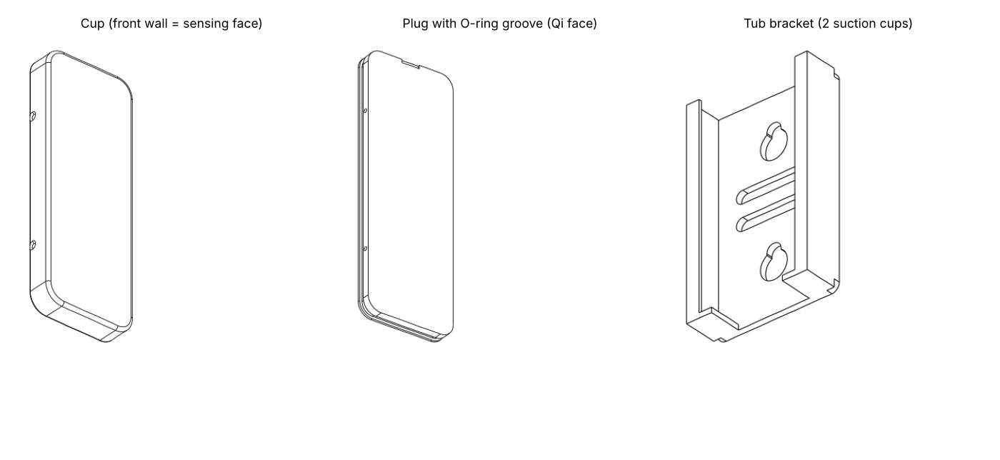

# Enclosure: off-the-shelf survey and custom O-ring design (rev A)

Requirements carried over from the design: fully sealed (IP68, bath depth plus warm-water cycling),
**no epoxy or potting** (serviceable), body-safe outer surfaces, a **flat thin front wall** pressed
onto the electrodes, a **flat back** within about 5 mm of a Qi pad, and as small as possible.

---

## 1. Off-the-shelf boxes: what's available

| Box | Outside (mm) | Verdict |
|---|---|---|
| Hammond 1555C2GY (PC, IP68) | 120 × 65 × 40.5 | **Fits the 112 mm PCB**, but has about 3.5× the volume of the custom design. The lid has molded standoffs and corner screw bosses, so the PCB can't lie flat on a wall. An air gap of ~1 mm costs most of the electrode signal (each 0.1 mm of air costs about 20 %), so the lid features would need to be ground off. Opaque grey (a clear-lid 1554 variant exists) |
| Hammond 1551 miniature (PC, IP68) | 60 × 35 × 22 / 80 × 40 × 22 | Too short for the 60 mm electrode ladder |
| Takachi WP (ABS/ASA, IP67) | smallest found 100 × 100 × 25 | Wrong shape, and IP67 (temporary immersion) |
| Takachi WH handheld (IP67) | 88 × 146 × 20 and up | Thin, but wide, IP67, and has a battery door (an extra seal) |
| Polycase / Bopla IP68 ranges | larger outdoor boxes | No slim (< 20 mm) IP68 part found |

**Conclusion:** no off-the-shelf IP68 box is thin and flat enough. If you want a quick first
prototype anyway, use the **Hammond 1555C2GY**: grind the lid standoffs flat, mount the PCB
electrode-side-down on the lid with thin double-sided tape, and put the coil on the base. Sensing and
charging will work, but the device will be bulky. The custom design below is recommended.

Sources: [Hammond 1555 datasheet](https://www.mouser.com/datasheet/2/177/1555-1289236.pdf),
[Hammond 1555C drawing](https://www.hammfg.com/files/parts/pdf/1555CGY.pdf),
[RS 1555C2GY listing](https://uk.rs-online.com/web/p/general-purpose-enclosures/2291128),
[Hammond 1551WHFLBK](https://www.buerklin.com/en/p/hammond/general-purpose-enclosures/1551whflbk/66H432/?view=GRID),
[Takachi WP (RS)](https://nz.rs-online.com/web/p/general-purpose-enclosures/1325359),
[Takachi WH (RS)](https://uk.rs-online.com/web/p/hand-held-enclosures/1325366),
[Takachi WH catalogue](https://www.takachi-enclosure.com/assets/attachments/images/takachi_plastic_handheld_enclosures_2021.pdf),
[Polycase IP68](https://polycase.com/ip68-enclosures).

---

## 2. Custom enclosure: cup + radial O-ring plug (no epoxy)

**Outside size: 43.8 × 119.8 × 10.1 mm** (internal cavity 39.4 × 115.4 × 7.4 mm). The cavity has 2.6 mm of extra length above the PCB so the ESP32 module clears the plug skirt. Three printed parts:

| Part | What it does |
|---|---|
| **Cup** | One piece: 1.2 mm flat front wall (the sensing face), 2.2 mm side walls, open back. A 0.8 mm thermal window sits behind the TMP117 tab. The bore entry has a 0.6 mm lead-in chamfer so it doesn't cut the O-ring |
| **Plug** | 1.5 mm flat back wall (Qi face) with a 2.2 mm skirt carrying the O-ring groove. Two posts press the PCB onto the front wall in the electronics band, and a pry notch at the top edge allows opening |
| **Bracket** | Stays stuck to the tub with 2 suction cups. The device slides in from the top and rests on two corner stops. Side lips overlap only the outer 3 mm of the front face, so the electrodes and the thermal window stay fully exposed. Lift the device out to charge |

### 2.1 How it seals

- **Radial (piston) O-ring seal.** The O-ring sits in a groove around the plug's skirt and is squeezed
  between the groove bottom and the cup's bore. Squeeze is set by the geometry, not by screw torque,
  so there is no flange, no gasket to crush evenly, and no glue.
- **Retention:** 4 × M2 × 4 mm A4-stainless self-tapping screws (for plastics) go through the side walls into the plug,
  on the **outside of the O-ring** (axis at Z 8.0 mm, groove at Z 4.3–6.6). Water can enter a
  screw hole but stops at the O-ring. The screws only stop the plug backing out, for example when warm water
  heats the trapped air: +30 °C gives about 10 kPa, which is about 50 N on the plug.
- **Internal clamping:** PCB 1.0, battery 4.0 (403040), coil 1.2 and 1.6 mm PORON foam (compressed to 1.2) fill
  the 7.4 mm cavity exactly. Closing the plug presses the electrodes flat on the front wall, which matters
  because each 0.1 mm of air gap costs about 20 % of the signal.

| Gland parameter (static radial, CS 1.5 mm) | Value |
|---|---|
| O-ring | **90 × 1.5 mm EPDM 70 Sh A** (hot water, soap and bath oils. Silicone also works but is less tear-resistant) |
| Installed stretch on the groove bottom | 3.3 % (groove perimeter 292.1 mm) |
| Groove depth / width | 1.05 / 2.30 mm |
| Radial clearance, plug ↔ bore | 0.10 mm |
| Squeeze | **22 % nominal**, 15–29 % with the plug pushed fully to one side |
| Groove fill | 65 % |
| Groove corner radius | 4.9 mm (≥ 3 × CS) |

These follow standard static-radial guidance (roughly 18–25 % squeeze, ≤ 85 % fill; see
[Marco Rubber](https://www.marcorubber.com/downloads/Marco-O-Ring-Gland-General-Design-Considerations.pdf),
[ERIKS](https://o-ring.info/en/technical%20manual/eriks%20-%20technical%20manual%20-%20o-ring%20gland%20design%20information.pdf),
[eFunda](https://www.efunda.com/DesignStandards/oring/design_guidelines.cfm)).

### 2.2 Fit check

`hardware/mech/fit_and_render.py` places the PCB (with the 5.5 mm top-corner radius now in the
placement-study board), the ESP32 module, a 1.35 mm envelope for all other back-side parts, the 403040 cell, the Qi coil and the foam at their real positions,
and intersects them with the cup and plug. **Interference is 0.000 mm³ for every pair.** The PCB front face
sits exactly on the front-wall inner face.

### 2.3 Printing at JLC3DP

| Option | Use | Notes |
|---|---|---|
| **SLA resin** (e.g. Ledo 6060, 8228) | **First prototypes** | Solid resin parts are watertight, and the bore and groove come out smooth enough for an O-ring. JLC itself says resin is not for outdoor or hot use. Bath water at ≤ 45 °C is fine for testing. Resin is **not certified for long skin contact**, so treat these as test units |
| **MJF PP** (polypropylene, if offered) | Better prototypes / small runs | Body-safe, hydrophobic (helps reject water films, see the electrode study), resistant to soap and oil. Slightly porous and rough, so lightly sand the bore and use a thin film of silicone O-ring grease |
| MJF PA12 nylon | Not recommended | Absorbs water and is porous at a 1.2 mm wall |
| **Injection-molded PP** | Production | Same geometry. Add 0.5–1° draft on the cup walls |

SLA/MJF tolerances (about ±0.1–0.2 mm) are the main risk for the seal. `PLUG_CLR` and `GLAND_DEPTH` in
`enclosure.py` are parameters: print one cup and plug, measure the bore and groove, and adjust
before ordering more.

Sources: [JLC3DP capabilities](https://jlc3dp.com/capabilities/3d-printing-service),
[JLC3DP SLA resins](https://jlcpcb.com/help/article/223-Comparing-SLA-Resin-Materials),
[JLC3DP MJF materials (incl. PP)](https://jlc3dp.com/blog/mjf).

### 2.4 Purchased parts (enclosure)

| Qty | Part |
|---|---|
| 1 | O-ring 90 × 1.5 mm, EPDM 70 Sh A (buy a few) |
| 4 | Screw M2 × 4 mm, A4 (316) stainless, self-tapping for plastics (PT/plastite style), flat head |
| 1 | PORON foam 1.6 mm, Ø30 mm (behind the coil) |
| 1 | Thermal gap pad 0.5 mm, 10 × 7 mm (TMP117 tab ↔ thermal window) |
| 2 | Suction cup Ø40 mm with mushroom head, see section 2.7 (e.g. Bambu Lab HA011) |
| – | Silicone O-ring grease (no epoxy anywhere) |

### 2.5 Assembly and leak test
0. Flash the firmware through the USB-C tab, then snap the tab off (pliers, one bend along the slots). No filing: the mouse bites sit on the edge line, so the stub is ≤ ~0.3 mm, and the cavity leaves 0.7 mm per side (the fit check models a 0.6 mm stub).
1. Put the gap pad on the cup's thermal window. Drop the PCB in electrode-side-first, then the battery, coil and foam.
2. Grease the O-ring lightly, roll it into the plug groove, and press the plug in (the lead-in chamfer guides it). Fit the 4 screws.
3. **Leak test before first bath use.** Put the closed device in a jar of water and pull a light vacuum
   (a hand vacuum pump or a food-saver jar). A stream of bubbles marks a leak. Then do 1 h at 0.5 m in 45 °C
   water, and 20 cycles between 15 °C and 45 °C. A humidity-indicator dot inside makes any ingress visible.
4. To open: remove the 4 screws and lever the plug out at the top notch.

### 2.5b Piezo sounder
A 20 mm piezo disc with leads (e.g. Murata 7BB-20-6L0) is bonded with cyanoacrylate to the plug's inner face, centred
at PCB (19, 23.5): between the two module clamp posts and the battery, so the plug panel becomes the sounding board.
Its two leads go to the BZ1 pads (PCB 25.3, 27.9). The fit check models it (0.45 mm incl. adhesive): 0 interference.
Bond it brass side down and keep the bond line thin; a soft (silicone) bond damps the sound.

### 2.6 Notes
- **Buoyancy:** it displaces about 53 cm³. In SLA resin the device weighs about 53 g (about neutral); in PP about 48 g and floats.
  It doesn't matter in the bracket. If floating is wanted, drop the plug posts and use foam instead.
- **LED:** natural (translucent) PP or a clear resin shows the status LED through the wall. With an opaque material,
  add a 0.8 mm thin spot in the plug above the LED.
- **Qi:** the coil sits 1.5 mm behind the plug's outer face, well inside the ~5 mm limit.
- **Body contact:** the outer surfaces are plastic only. The screw heads are A4 stainless (passive, very low nickel release)
  and sit on the side walls.

### 2.7 Suction cups (sourced)

The bracket takes **two 40 mm mushroom-head suction cups**. You push the head through the round end of each
keyhole and then hang the bracket so the neck slides to the top of the slot. Industrial vacuum cups
(Festo, Piab, Zimmer…) are made to work with a vacuum pump and don't hold on their own, so they aren't suitable here.

| Option | Why | Source |
|---|---|---|
| **Bambu Lab "Suction Caps with Mushroom Head", 40 mm, part HA011 (10 pcs, clear PVC)** (recommended) | Mushroom head made for keyholes, one stable part number, cheap (about US$1.50 per 10), sold in the US, EU, UK, AU and Asia | [US store](https://us.store.bambulab.com/products/suction-caps-with-mushroom-head), [EU store](https://eu.store.bambulab.com/en-be/products/suction-caps-with-mushroom-head) |
| Kinter "Premium Suction Cup – Mushroom Head" (clear, UV-resistant PVC) | US maker that designs these cups specifically for keyhole openings. Check sizes with Kinter | [Kinter](https://products.kinter.com/viewitems/all-categories/premium-suction-cup-mushroom-head) |
| Flintronic 40 mm mushroom-head 12-pack (PVC, with hooks) | Widely sold on Amazon. Leave the hooks off | [listing](https://ibspot.com/products/flintronic-suction-cups-pack-of-12-clear-plastic-suction-cups-diameter-40-mm-pvc-wall-hooks-with-suction-cup-and-hooks-transparent-plastic-suction-cups-suction-cup-hooks-extra-strong-for) |
| Adams 1-3/4" (44.5 mm) cups with stud + knurled nut, 25-pack (alternative) | Bolt-through instead of keyhole. The stud fits the 6 mm slot, with the nut on the device side of the bracket. A buyer reports the stud can pull out of the cup, so it's the second choice | [listing](https://www.dkhardware.com/1-3-4-medium-suction-cups-with-studs-and-knurled-nuts-25-suction-cups-asc134n-product-26445.html) |

**The keyhole in `enclosure.py` is parametric** because none of these vendors publish head or neck sizes:
it takes heads up to 12 mm across and 3.5 mm tall, and necks up to 5.8 mm, with a 7 mm slide. Before printing the
bracket, measure the cups you bought and set `KEY_HEAD_D`, `KEY_NECK_W` and `KEY_POCKET`.

Tips: an acrylic tub is ideal (smooth and non-porous). Clean the spot with isopropyl alcohol and press the cups
on with the tub dry and warm. A drop of water on the rim helps. PVC cups stiffen over months, so replace them
if they start to creep (two cups per bracket is about 10× more holding force than the device needs). Suction cups won't
hold on textured anti-slip areas.

Outputs: `hardware/mech/out/{cup,plug,bracket}.step|.stl`, `assembly.step`. Rebuild with
`python3 hardware/mech/enclosure.py` and check with `python3 hardware/mech/fit_and_render.py`.
