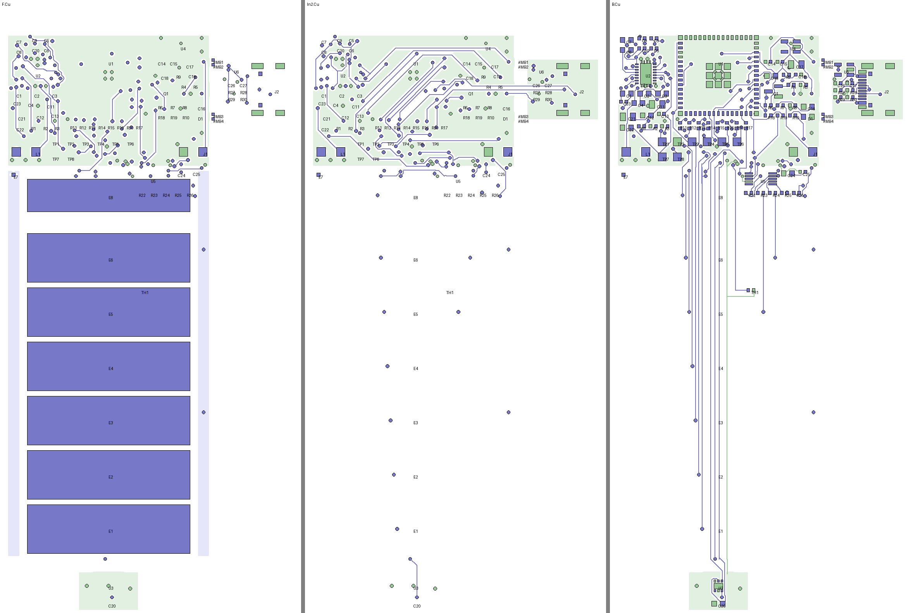

# PCB routing and JLC order files

The board is placed and partly hand-routed. **One step remains: the autoroute of the dense electronics band.**

## Pipeline
```
python3 hardware/tools/gen_schematic.py && python3 hardware/tools/verify_netlist.py
python3 hardware/tools/route.py prep          # fresh placement + hand routing -> hardware/kicad/route/bath_monitor.dsn
<autoroute>                                   # bath_monitor.dsn -> bath_monitor.ses   (see below)
python3 hardware/tools/route.py finish        # import, GND stitching, zone refill, DRC report
python3 hardware/tools/jlc_outputs.py         # hardware/fab: gerbers zip, bom_jlc.csv, cpl_jlc.csv (FDC1004 build;
                                              #   --variant=touch or --variant=both, see docs/sensing-options.md)
```

## What `route.py prep` already does
- **Electrode lanes:** a via inside each of the 7 electrodes, then a straight 0.2 mm lane on B.Cu up to the electronics
  band. B.Cu sits behind the hatched In1 SHIELD, so the lanes are shielded from the water.
- **TMP117 bus and NTC:** straight B.Cu lanes through the electrode band to the thermal tab and to TH1.
- **Thermal vias** under the BQ51050B exposed pad and the ESP32 module's ground pads (0.3 mm drill, JLC standard).
- **Autorouter constraints** (in the DSN only):
  - keep-out over the whole electrode band;
  - In1/In2 marked as planes, so they stay unbroken GND / SHIELD;
  - hand routing marked *protected*.

## The autoroute
Freerouting (open source) reads the DSN and writes the SES. Any of these works:

1. **KiCad app:** File → Export → Specctra DSN is already done. Open `hardware/kicad/route/bath_monitor.dsn` in
   Freerouting (GUI), click *Autorouter*, then *File → Export Specctra Session File* to `bath_monitor.ses`.
2. **Command line:** `java -jar freerouting.jar -de hardware/kicad/route/bath_monitor.dsn -do hardware/kicad/route/bath_monitor.ses -mp 30`
3. **Claude:** approve running the Freerouting jar in this environment, and the whole pipeline runs end to end.
   This is the step that was paused: it needs you to OK executing a downloaded program.

Then run `route.py finish`. Pass criteria: DRC with **0 unconnected items, 0 clearance errors**. Silkscreen
warnings are cosmetic.

## Status (2026-11-21): fully routed



`hardware/kicad/bath_monitor.kicad_pcb` is routed: **0 unconnected, 0 clearance / hole / edge errors, no
dangling copper**. The pad connectivity matches the schematic netlist (54 nets; the TMP117 exposed pad is
tied to GND, which the symbol has no pin for). The only DRC items left are cosmetic warnings: silkscreen
overlaps and silk clipped by mask or edge (back silk only carries designators), plus `lib_footprint_issues`
because the footprints are embedded rather than read from a library.

How it got there:

1. Freerouting 1.9 (`route.py prep` / `finish` / `again`, run under `xvfb-run`) does the bulk.
2. `tools/fixroute.py` is a small grid A* router (F.Cu / In2 / B.Cu, DRC-driven). It reroutes what is left,
   does transactional rip-up (kept only if the DRC score improves), adds GND island vias, and falls back to
   0.15 mm tracks and 0.5/0.25 mm vias in fine-pitch spots. Run it after any edit:
   `python3 hardware/tools/fixroute.py`.
3. A few spots were laid out by hand (locked tracks):
   - **FDC block.** R23 (PAD5) and R24 (PAD6) drop straight down on B.Cu to a via inside their own
     electrodes E5 / E6, so no long detours are needed. U5 pin 7 GND reaches In1 through a small GND
     tongue cut into the shield plane above the REF electrode. No vias are allowed over E8 (REF) except
     REF's own.
   - **U2 right-side fan-out.** Pins 4–6 (VBAT, CLAMP1, COMM1) fan out to staggered vias. VBAT then joins
     its In2 run.
   - **R5 / R28 GND.** Each has its own GND via. The RECT and TAB_CC2 links were moved off them.
   - **TMP117.** GND vias in the exposed pad and beside it tie the split B.Cu pour through F.Cu.
   - **Right F.Cu shield strip.** Two vias tie it to the In1 shield plane.

Four vias are 0.5 / 0.25 mm (GND ×3 and CLAMP1). Everything else is 0.6 / 0.3 mm. The minimum track is
0.15 mm; the default is 0.2 mm.

Then `python3 hardware/tools/jlc_outputs.py` writes `hardware/fab/` (gerbers zip, `bom_jlc.csv`,
`cpl_jlc.csv`). The folder is git-ignored, so regenerate it before ordering.

## Order settings at JLCPCB
| Option | Value |
|---|---|
| Layers / thickness | 4 / 1.0 mm, stackup JLC04101H-7628 |
| Solder mask / silkscreen | **White** / black (the electrodes show through the translucent case) |
| Surface finish | ENIG |
| Min via | 0.25 / 0.5 mm on four vias (rest 0.3 / 0.6). Check the order page; if JLC surcharges sub-0.3 mm holes, the four can be hand-nudged to 0.3 mm |
| Assembly | **Bottom side**, standard PCBA, files `bom_jlc.csv` + `cpl_jlc.csv` |
| Not assembled | Electrodes (copper), test pads, battery and Qi coil (hand-soldered) |

Check the rotations in JLC's placement preview. KiCad and JLC sometimes disagree by 90/180° per footprint. Fix them in
`ROT_FIX` in `jlc_outputs.py`. Parts marked *verify* in `hardware/lcsc_parts.csv` are well-known JLC Basic numbers
that weren't confirmed by search in this session: check them on the order page.
