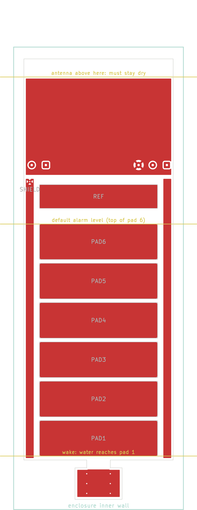
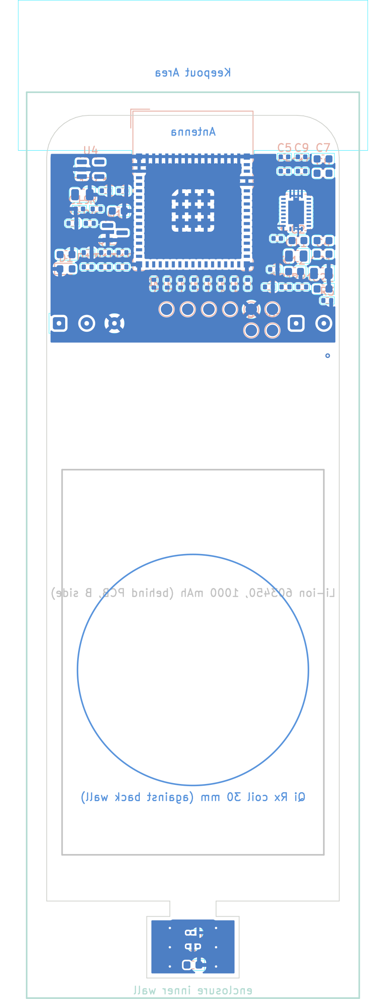
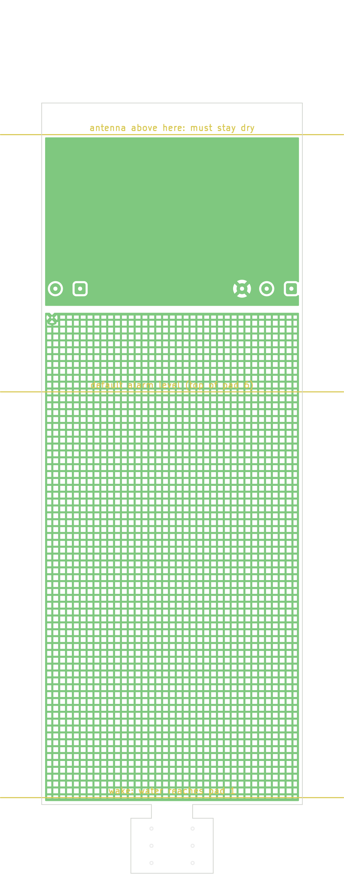
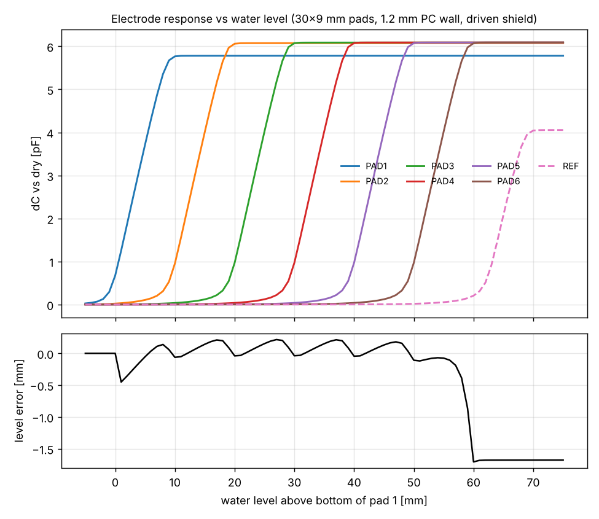
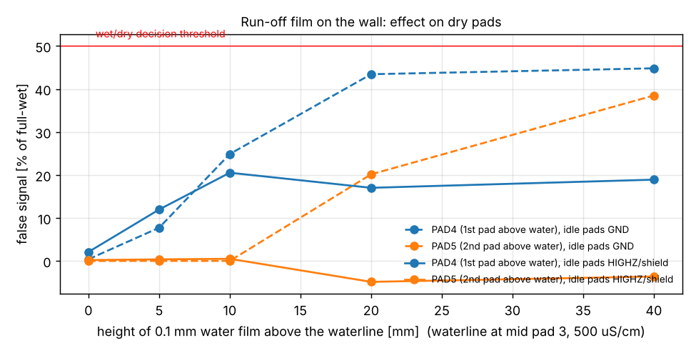

# Board placement study and level-electrode design (rev A)

This study covers how the PCB is laid out, where every block sits relative to the water, and
how the through-wall level electrodes were sized and checked. All numbers come from files in
this repo:

| Artifact | Source |
|---|---|
| Placement-study PCB (all footprints placed, nets assigned, zones filled, **not routed**) | `hardware/kicad/bath_monitor.kicad_pcb`, generated by `hardware/tools/gen_pcb.py` |
| Electrode field simulation | `hardware/tools/electrode_sim.py` → `docs/img/electrode_*.png` |
| Layer images | `docs/img/pcb_*.png` (exported with `kicad-cli pcb export svg`) |

---

## 1. Minimised component set

All passives were collapsed onto a few standard values. That gives fewer JLC feeder setups
(each extended part costs a loading fee) and fewer chances to mix up parts.

| | Before | After |
|---|---|---|
| Unique capacitor lines | 12 | **7**: 100nF 50V 0603, 22nF 50V 0402, 10nF 50V 0402, 470nF 25V 0603, 2.7nF C0G 0603, 1uF 25V 0402, 10uF 25V 0805 |
| Unique resistor lines | 9 | **4**: 1k, 10k, 1M, 196R (all 1 %) |
| Total BOM lines (incl. ICs, LED, FET, NTC, hand-soldered coil + battery) | 29 | **20** |

How each merge was done:
- **Qi series resonant capacitor C_s** = 100n + 100n + **22n** = 222 nF, reusing the decoupling and COMM-cap values. That replaces the dedicated 33 nF part. Resonance with an 11 µH coil is 102 kHz, within the coil's own tolerance, and is bench-tuned anyway.
- **Charge-current setting**: R_ILIM = R1 + R_FOD = 2k + 196R = 2196 Ω, giving I_BULK = 314 AΩ / 2196 Ω = **143 mA** (0.45C for the 320 mAh cell). That's below the datasheet's characterised 500–1500 mA range, which TI says on E2E is acceptable with reduced accuracy ([TI E2E: low charge current accuracy](https://e2e.ti.com/support/power-management-group/power-management/f/power-management-forum/576502/bq51050b-low-charge-current-accuracy)). TI recommends starting R_FOD at about 200 Ω, which matches 196R.
- **Qi-present detector**: the 100k/100k divider became 1M/1M. The BSS138 gate still sees RECT/2 (2.5 V at 5 V RECT, 7.5 V worst case), and the off-pad current is still 0.
- **Touch series resistors**: 510R → 1k, shared with the LED resistor. With about 1 pF of pad capacitance the RC is 1 ns, which doesn't matter at the touch peripheral's ~1 MHz rate, and the larger value improves ESD/RF filtering.
- **Decoupling and bulk**: all 1 µF caps are one 25 V part, all 10 µF caps are one 25 V 0805 part (also good enough for RECT), and all 100 nF caps are one 50 V 0603 part (also good enough for the resonant tank).
- **R3 (TERM)** = 10k: R_TERM = 240 Ω/% × %I_BULK, so charging stops at 41.7 % of 143 mA = about 60 mA. That's above TI's 30 mA guidance and ends at roughly 90 % full, which is easier on cycle life. Bench-verify that termination works.
- **TH1**: a PCB-mounted 10k B3380 NTC (Murata NCP15XH103F03RC) pressed against the cell. It adds one BOM line, but means any 2-wire protected cell can be used.
- **Added**: a dry reference electrode (E8) on IO7 with its own 1k. It adds a part but **no new BOM line**.

---

## 2. Board floor-plan

Board: **38 × 102 mm body + 12 × 10 mm thermal tab** (top corners R5.5 to pass the enclosure's O-ring bore), 4 layers, 1.0 mm FR-4, all components on
the **back** (single-sided SMT at JLC). Height bands, from the top (dry) to the bottom (first to get wet):

| Band (from top) | Height | Contents | Why here |
|---|---|---|---|
| 0–4.6 mm | 4.6 | ESP32-S3 antenna. **No copper on any layer** across the full width | Must stay above the water. 2.4 GHz is absorbed within millimetres of water |
| 4.6–29.5 mm | 25 | All electronics: module, Qi charger, LDO, detector, touch resistors, test pads, coil + battery solder pads. Solid GND on all 4 layers | Kept dry and close together. The GND pours end before the electrodes start |
| 32–38 mm | 6 | **REF** dry reference electrode | Never wet in normal use. Tracks drift from temperature, humidity and nearby hands. If it does get wet, the water is far above the alarm level |
| 42–101 mm | 60 | **Level electrodes PAD6 … PAD1**, 30 × 9 mm at 10 mm pitch | The 60 mm sensing range. PAD6 top = default alarm level |
| 102–112 mm | 10 | **Thermal tab** with TMP117 | Lowest point, so it is wet before the level sensor wakes. The 6 mm neck limits heat flow from the board |

**Back-side groups** (view is mirrored, as seen from the back):
- **Qi charger column** (front-view left): BQ51050B surrounded by its BOOT/COMM/CLAMP caps. The tank caps and ILIM/FOD/TERM resistors sit right below it, and the coil solder pads are directly beneath, so the AC loop stays small.
- **Power / housekeeping column** (front-view right): LDO + caps, EN RC, Qi-present detector, battery divider, I²C pull-ups, LED.
- **Touch resistors**: a row directly under the module's GPIO edge, so every electrode trace leaves the electronics zone after one 1k resistor.
- **Pogo test pads**: 3V3, GND, EN, IO0, USB D+/D−, VBAT, RECT, used for programming before the battery is fitted.
- **Battery** (320 mAh, 25.5 × 36 × 4.3 mm, spanning PCB y 50–86) sits behind the electrode band, with TH1 under its top edge. **Qi coil** (Ø30 mm) sits behind the battery against the back wall. Its ferrite faces the battery and shields it.

**Stack in the electrode band** (front to back): wall 1.2 | PCB 1.0 | battery 4.3 | coil + ferrite 1.2 | foam 1.25 (swelling buffer) | back wall 1.5, giving **10.45 mm**. Because the electronics band has no battery behind it, the module (2.4 mm) fits within the same envelope. The enclosure ([enclosure.md](enclosure.md)) is **43.8 × 119.8 × 10.45 mm**, with a 7.75 mm cavity: PCB 1.0 + battery 4.3 + coil 1.2 + foam 1.25.

**Checks run on the placement**: no courtyard overlaps, every part inside the outline, KiCad DRC shows
no clearance / keep-out / footprint errors. Only unrouted nets, silkscreen cosmetics,
and thermal-spoke warnings remained at that stage; the board is now fully routed (see [pcb-routing.md](pcb-routing.md)). The QFN's built-in 0.2 mm
thermal vias were dropped in favour of 0.3 mm vias (JLC standard) to be added during routing.

### Layer usage

| Layer | Electronics band | Electrode band |
|---|---|---|
| L1 F.Cu (faces wall) | GND pour | Electrodes; driven-SHIELD side strips (2.1 mm wide, 1.5 mm gap) |
| L2 In1.Cu | GND | **Hatched SHIELD** (0.3 mm lines / 0.7 mm gaps), behind every electrode |
| L3 In2.Cu | GND | **No copper** (keeps the shield's load small) |
| L4 B.Cu | Components + GND pour | Electrode traces only (shielded from the water by L2); battery behind |

Alternatives considered:

| Option | Verdict |
|---|---|
| **A. Electronics on top, electrodes below, battery behind electrodes (chosen)** | Thinnest stack. Antenna highest. All GND copper away from the sensing area. Single-sided assembly |
| B. Electronics behind the electrodes, battery below | The device gets 2.5 mm thicker (battery and parts can't share depth). GND copper behind the pads loads the shield |
| C. Electronics and electrodes side-by-side | Device about 60 mm wide. Antenna closer to the water |
| Electrodes on the back layer (no front copper) | Adds 1 mm FR-4 to the wall path, which costs about 40 % of the signal. Rejected |

---

## 3. Electrode design

### 3.1 Sensing principle and model
Each electrode and the water outside the wall form a capacitor through the wall. Tap water
(50–1000 µS/cm) behaves as a conductor at the ~1 MHz touch rate, so a wet electrode gains about
`ε0·εr·A / t_wall` of capacitance. `electrode_sim.py` solves the full complex-permittivity field
problem on a vertical cross-section. It includes the FR-4, the hatched L2 shield, the battery
behind, the wall, bulk water, and optional water films. Each electrode is driven in turn, and the
result is scaled to the 30 mm electrode width (fringing at the ends of each electrode is ignored).

### 3.2 Result: response vs level

| Quantity | Value (1.2 mm PC wall) |
|---|---|
| Dry baseline per electrode (driven shield, idle pads HIGHZ) | **0.9 pF** (PAD1 1.5 pF, near the tab GND) |
| Change when fully wet | **+5.8 pF**, a 650 % change. Touch-sensor noise is in the 0.01 pF range |
| Response across one pad | Close to **linear** as the water climbs it |
| Level from interpolation, `L = Σ clamp(ΔC_k / ΔC_full,k) × 10 mm − 1.7 mm` | **±0.9 mm worst, 0.19 mm rms** over the full 60 mm |

So plain rectangular pads already give a continuous level reading. Interleaved or wedge-shaped electrodes
would add nothing. Six channels give a 60 mm range and keep redundancy (the alarm doesn't depend
on one channel's calibration). Each pad's own full-wet value is learned as the water passes it, so
no factory calibration is needed. The −1.7 mm is a fixed fringe-field constant.

### 3.3 Shield: why it is driven
| Shield on L2 | Dry baseline | Wet/dry change |
|---|---|---|
| **Driven** (T14, same waveform as the pad) | 0.9 pF | 650 % |
| Same hatch grounded | 40.6 pF | 14 % |

A grounded plane 0.2 mm behind the pad would swamp the signal. Driving the plane removes it, so drift
in the touch peripheral and in temperature becomes negligible relative to the water signal.
The ESP32-S3 shield driver is specified for about 40–320 pF of shield load (driver levels L0–L7). Hatching
L2 and leaving L3 empty under the electrodes keeps the shield load well inside that range. *Measure the
shield load on the first boards.*

### 3.4 Water films and condensation

A continuous 0.1 mm run-off film above the waterline is the worst case.
- **Idle electrodes must not be grounded.** When grounded, the film couples the measured pad
  sideways into its grounded neighbours. The second pad above the water then reads up to 38 %
  "wet" and the first up to 45 %.
- **Idle electrodes in HIGHZ** (`touch_pad_set_idle_channel_connect(TOUCH_PAD_CONN_HIGHZ)`) float up to the
  shield potential through their large coupling to L2. The false signal is then ≤ 1 % from the
  **second** pad up, and ≤ 21 % on the first pad above the waterline.
- **Conductivity matters.** With strongly salted water (bath salts, 5000 µS/cm), the pad just above the waterline
  can reach about 65 %. Even then the error is limited to that one pad, and it always reads
  **high**, so the alarm can only come early (fail-safe).

Design rules that follow:
1. **HIGHZ idle channels** (firmware), and the driven shield on L2 plus the L1 side strips.
2. **Monotonic level logic**: pad k+1 only counts once pad k reads ≥ 90 %. An isolated "wet" pad above a dry one is treated as a splash or film and ignored after a short time.
3. **Wet/dry decisions at 70 % of the learned full-wet value**, above the worst film case at normal tap-water conductivity.
4. **Hydrophobic wall surface**: polypropylene sheds water as beads rather than a sheet, which removes most of the film case.

### 3.5 Wall material and thickness

| Wall | 0.8 mm | 1.2 mm | 1.6 mm | 2.0 mm |
|---|---|---|---|---|
| PC (εr 2.9), full-wet ΔC [pF] | 8.8 | **5.8** | 4.3 | 3.4 |
| PP (εr 2.2), full-wet ΔC [pF] | 6.6 | **4.4** | 3.2 | 2.5 |

Every option gives more than 100× the touch noise, so the wall can be chosen for strength and sealing.
**Recommendation: 1.2 mm wall.** Use **polypropylene** for production (hydrophobic, body-safe,
resistant to soap and bath oils, and the 25 % lower signal doesn't matter). PC or SLA resin is fine for prototypes.
Keep the wall **flat and of even thickness** over the electrode band, and press the PCB against it with
a thin, even adhesive (no air gaps: 0.1 mm of air costs about 20 % of the signal).

### 3.6 Final electrode specification
| Item | Value |
|---|---|
| Level electrodes | 6 × (30 × 9 mm), 1 mm gaps, 10 mm pitch, L1, solder-masked (no exposed copper) |
| Reference electrode | 30 × 6 mm, 4 mm above PAD6 |
| Driven shield | L1 side strips + L2 hatch 0.3/0.7 mm across the whole electrode band, driven by T14 through 1k |
| Behind the shield | L3 empty, L4 electrode traces only, battery pouch at about 0.6 mm |
| Wake channel | PAD1 (bottom), deep-sleep touch wake |
| Firmware settings | Idle channels HIGHZ, per-pad learned full-wet value, 70 % decision threshold, monotonic level logic, REF-based drift compensation |

---

## 4. Limits of this study / next steps
- The model is 2-D and quasi-static. Fringing at the left/right ends of each electrode and the water's
  return path through the rest of the enclosure are approximated (ΔC is an upper bound by about 10–15 %).
  That doesn't change any decision above, and the margins are 100× or more.
- The "HIGHZ ≈ driven" assumption for idle pads must be confirmed on hardware (log raw counts
  with a wetted wall).
- The BQ51050B values have been checked against the TI datasheet (SLUSB42F): K_ILIM, K_TERM, the
  120 mA termination minimum, the BOOT/COMM/CLAMP/RECT/BAT capacitors, AD/AD-EN/EN2 handling, and the
  internal NTC bias (designed for a 10 kΩ B3380 NTC directly). Still to tune on the bench:
  the resonant capacitors for the chosen coil, and R_FOD (FOD calibration).
- The PCB is placed but **not routed**. Routing, 0.3 mm thermal vias under the QFN, and silkscreen
  clean-up are next.
