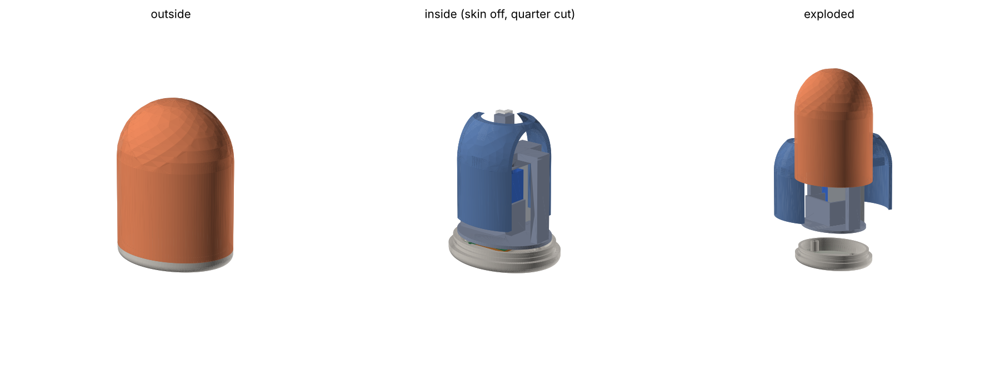

# squeeze: pass a squeeze across the house

Two soft, glowing pebbles, one for a parent and one for a child. Squeeze yours and the other one squeezes
its holder's hand with the same rhythm and strength, live. Squeeze a pattern; get it squeezed back.
It doesn't judge or score; it just passes squeezes back and forth.



- **Sense:** the whole pebble is a sealed air volume under a 2 mm silicone skin. A squeeze raises the pressure
  0.6–2+ kPa, read by a BMP280. Auto-ranging, so a child's squeeze counts as much as an adult's.
- **Squeeze back:** an SG90 servo turns an oval cam that pushes two curved plates 3 mm out into the palm and
  fingers, in proportion to the partner's squeeze.
- **Link:** ESP-NOW between the two units' ESP32-C3 modules: no router, no app, ~5 ms. Turn-taking: whoever squeezes first
  has the floor, and a squeeze back during the partner's still gets through (duplex sensing).
- **Power:** Qi charging (brim's BQ51050B block and coil), 400 mAh LiPo. Sleeps by itself and wakes on a squeeze or when the
  partner calls.
- **Enclosure:** 52 × 42 × 70 mm. Cast Dragon Skin 10 skin in each person's colour, glowing from inside. The 3D-printed
  mold is included.

| | |
|---|---|
| [`docs/design.md`](docs/design.md) | Requirements, sensing, mechanism, electronics, radio, behaviour and LED legend, enclosure and casting, build plan, safety, risks |
| [`docs/ordering.md`](docs/ordering.md) | **What to order where** (JLCPCB board + assembly, JLC3DP prints, hand parts), skin casting, assembly and first flash |
| [`docs/schematic.md`](docs/schematic.md) | The board's netlist, part by part (generated from `hardware/tools/parts.py`) |
| [`hardware/fab/`](hardware/fab/) | JLC order files: gerbers zip, `bom_jlc.csv`, `cpl_jlc.csv`, `hand_parts.csv` |
| [`firmware/`](firmware/) | ESP-IDF 5.3 (ESP32-C3). Pure logic host-tested: `make -C firmware/test` |
| [`hardware/mech/`](hardware/mech/) | CadQuery model, fit check and renders. STEP/STL in `out/` |
| [`docs/virtual-experiments.md`](docs/virtual-experiments.md) | Bring-up and usability rehearsed in simulation before ordering: two rounds, every problem found is fixed |
| [`firmware/sim/`](firmware/sim/) | Test bench: the real firmware for both units against simulated hardware and people |

```
# host tests and the two-unit simulation (no hardware)
make -C squeeze/firmware/test
(cd squeeze/firmware/sim && make && python3 experiments.py)
python3 squeeze/hardware/tools/erc.py              # static electrical checks

# firmware: one build per unit (same code, different role/colour/strength)
cd squeeze/firmware
. ~/esp/esp-idf/export.sh                          # ESP-IDF v5.3.2 (verified: both build, 0 warnings)
idf.py -B build-parent -D SDKCONFIG=build-parent/sdkconfig -D "SDKCONFIG_DEFAULTS=sdkconfig.defaults;sdkconfig.parent" set-target esp32c3 build
idf.py -B build-child  -D SDKCONFIG=build-child/sdkconfig  -D "SDKCONFIG_DEFAULTS=sdkconfig.defaults;sdkconfig.child"  set-target esp32c3 build
idf.py -B build-parent -p /dev/ttyACM0 flash monitor
# set the same "Pair secret" on both first: idf.py menuconfig -> Squeeze pair

# main board (KiCad 7: apt install kicad kicad-footprints kicad-symbols)
python3 squeeze/hardware/tools/gen_pcb.py         # board from parts.py: outline, placement, planes
python3 squeeze/hardware/tools/autoroute.py --jar freerouting-1.9.0.jar --passes 60   # Freerouting (Java 17+, xvfb-run)
python3 squeeze/hardware/tools/route.py           # finish: GND islands, last connections (brim's fixroute.py, adapted)
python3 squeeze/hardware/tools/hand_fixes_revA.py --gnd   # only if a GND pad is left on a pour island
python3 squeeze/hardware/tools/widen.py           # widen power tracks where the copper allows
python3 squeeze/hardware/tools/render_pcb.py      # docs/img/pcb_layers.png
python3 squeeze/hardware/tools/drc.py             # DRC summary
python3 squeeze/hardware/tools/jlc_outputs.py     # hardware/fab: gerbers zip, BOM, CPL, hand parts
python3 squeeze/hardware/tools/netlist_doc.py     # docs/schematic.md

# enclosure
python3 squeeze/hardware/mech/squeeze_unit.py     # STEP/STL
python3 squeeze/hardware/mech/fit_and_render.py   # interference check at rest and full swell, renders
```

Status: **rev A, ready to order.** Main board routed and DRC clean; JLC files in `hardware/fab/`; printed parts in
`hardware/mech/out/`; step by step in [docs/ordering.md](docs/ordering.md). Not yet built: the firmware builds with ESP-IDF
v5.3.2 and runs on the PC test bench, but has not run on the chip; the first boards need the bring-up checks in
design.md §9.
