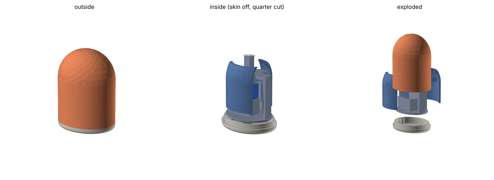
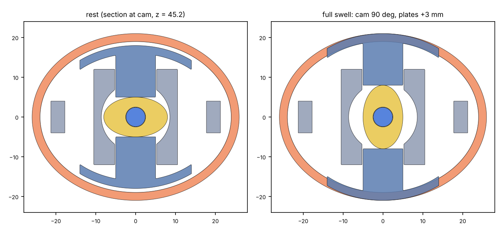
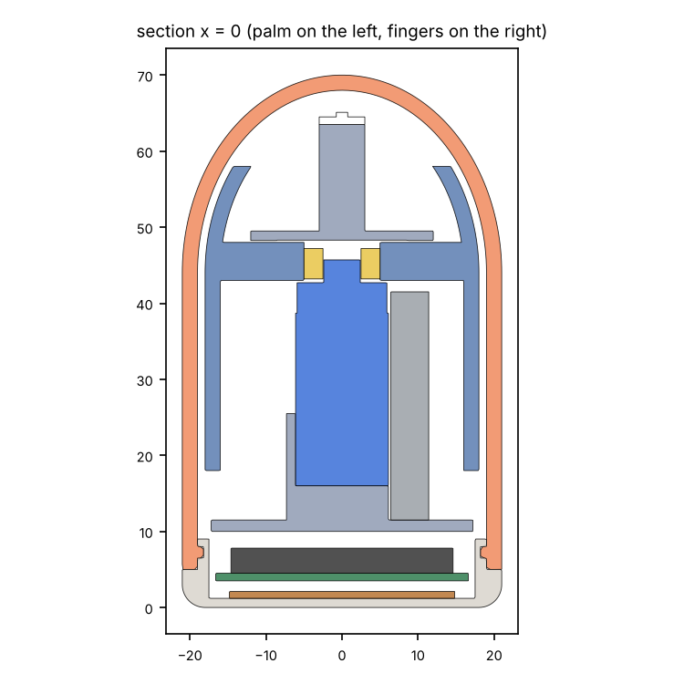
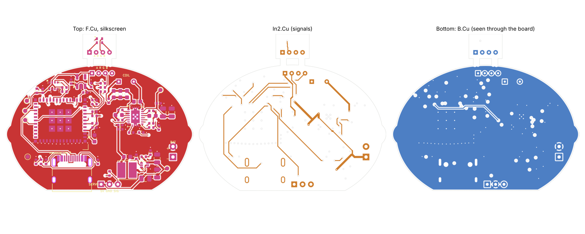
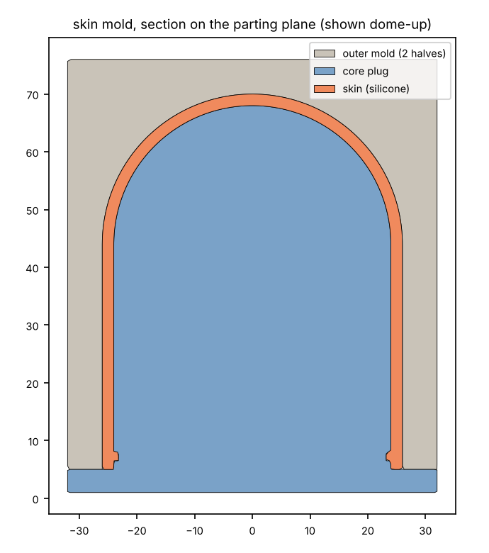

# squeeze: system design (rev A)

Two identical hand-held pebbles. Squeeze yours and the other one squeezes its holder's hand
with the same rhythm and strength, live. It recreates a game: one person squeezes a pattern
into the other's hand, the other squeezes it back, then the pattern changes. The device only
**passes squeezes back and forth**. It doesn't score, judge or record anything.

Scope: a **one-off pair** (a parent's unit and a child's unit) with a finished, giftable enclosure.
Nothing here is aimed at certification or volume production. Section 10 notes what would change for that.



---

## 1. Requirements

| # | Requirement | Design response |
|---|---|---|
| R1 | Sense a squeeze, including how hard, from a 6-year-old and from an adult | The whole unit is one sealed air volume under a soft silicone skin. A BMP280 pressure sensor reads the rise (0.6 to 2+ kPa). Auto-ranging makes each holder's strongest recent squeeze full scale |
| R2 | Reproduce it as a squeeze in the other hand, not a buzz | Servo and oval cam push two curved plates 3 mm outward into the palm and the fingers, in proportion to the partner's squeeze |
| R3 | Work apart (different rooms) | ESP-NOW radio between the two ESP32-C3s: no router, no app, no pairing step, about 5 ms latency. Section 6 covers range and the option of working across the internet |
| R4 | Pass back and forth, no judging | Turn-taking: whoever squeezes first has the floor until they let go. No scoring logic exists |
| R5 | Nice enclosure | Soft-touch cast silicone in each person's colour, glows from inside, no buttons, no ports, no seams on the grip |
| R6 | Safe for a 6-year-old | Travel-limited actuator (3 mm, under 2 mm of silicone). No pinch points: the skin covers every moving part. Protected cell. Sealed. Child's unit squeezes more gently |
| R7 | Easy to live with | Qi charging on any pad. Sleeps by itself and wakes when squeezed or when the partner squeezes |

### Left out on purpose
- **Buttons and screens.** A squeeze wakes it, and the LED says what is going on.
- **A phone app.** Nothing to configure. The two units are paired by a shared secret at build time.
- **USB port.** It would break the air seal that the sensing relies on. Charging is Qi, and flashing is done with the base off (3 minutes, section 8).
- **Vibration motor.** It would be a buzz. The plates already give the "your partner is here" cue.

---

## 2. Architecture

```
                 squeeze                                   partner's squeeze
   hand ──► skin ──► air pressure ──► BMP280                 ──► servo ──► cam ──► plates ──► hand
                                         │ I2C 50 Hz              ▲ PWM          (3 mm)
                                         ▼                        │
                              ┌───────────────────────┐   5 V via boost + load switch
     Qi pad ┄┄► coil ──► BQ51050B ──► LiPo ──► ESP32-C3-MINI-1U ──► RGB LED (through the silicone)
                (charger, as brim)   503030   │  grip.c  turn.c  shaper.c
                                              ▼
                                 ESP-NOW broadcast, 12-byte frames ◄┄┄┄┄► the other unit
```

Both units run the same firmware. One build option (`SQZ_ROLE`) picks its colour and how hard it squeezes.

---

## 3. Sensing: sealed air under a soft skin

The silicone skin is cast as a one-piece hood. Its bottom lip snaps into a groove on the rigid base and
is sealed with a bead of RTV. Everything inside is one air volume: **52 cm³** of air, according to the CAD
(`fit_and_render.py`). Over the two plates there is a **1 mm air gap** under the skin. A squeeze pushes the
skin into that gap and the pressure rises:

| Squeeze (CAD estimate) | Volume change | Pressure rise |
|---|---|---|
| skin pressed 0.3 mm over half the plates (light, child) | 0.31 cm³ | **+0.6 kPa** |
| 0.6 mm over half | 0.63 cm³ | +1.2 kPa |
| 0.9 mm over 60 % (firm, adult) | 1.13 cm³ | **+2.2 kPa** |

The BMP280 at x4 oversampling has noise of a few Pa, so even a light squeeze is about 100 times the noise.
The firmware (`grip.c`) handles:

- **Baseline tracking.** Body heat (+1 °C ≈ +0.34 kPa), the weather and the plates' own heating move the
  pressure slowly. The baseline follows with a 4 s time constant when nobody is squeezing (1 s when the
  pressure is falling). A "squeeze" that lasts more than 10 s is treated as drift and re-zeroed.
- **Hysteresis.** A squeeze starts above +150 Pa and ends below +80 Pa.
- **Auto-range.** The strongest rise in the last ~30 s is full scale, with a floor of 800 Pa. A child's
  firm squeeze and an adult's firm squeeze both send "1.0", so neither has to squeeze harder to be felt.
- **Masking.** While the unit's own plates move, its pressure says nothing about its holder, so the
  reading is ignored (section 7, turn-taking).

**Altitude:** a sealed unit balloons slightly in an airplane cabin (about −25 % pressure). It is fine in a car or a house.
A flight is untested. If that matters, a 0.2 mm pin vent in the base would equalise in about a minute and
would cost roughly 5 % of the signal on a 3 s squeeze.

---

## 4. Actuation: the cam and the plates



- **Servo:** SG90-class micro servo, standing in the chassis cradle (cut off its mounting tabs), shaft up.
- **Cam:** an oval, 16 × 10 mm (semi-axes 8 and 5), 4 mm thick, glued to the servo's stock horn. At rest its
  short axis faces the plates. Turning it 90° pushes each plate out **3 mm**.
- **Plates:** two curved 2 mm shells (28 × 44 mm) that follow the inside of the skin, one under the palm and
  one under the fingers. Each has a boss that slides in a tunnel in the cam housing, so the plates
  translate straight out (no hinge).
- **Return:** two pegs on each plate's inner face, high up at z = 55 mm. A 10 × 1.5 mm silicone O-ring is stretched
  across to the opposite plate's peg on each side, so the plates always stay on the cam.
- **Proportional:** the partner's level 0–1 maps to plate travel through the inverse of the cam's lift
  curve (`shaper_cam_inverse`), so half a squeeze gives half the travel. The servo is slew-limited to
  600°/s (an SG90's full speed is about 0.1 s per 60°).
- **Strength:** the travel limits how hard it can squeeze, not the servo's torque. The plates can move
  at most 3 mm, through 2 mm of Shore 10A silicone. Hand tissue at 2–5 N/mm caps the push at roughly
  6–15 N, a gentle hand squeeze. The **child's unit** uses 65° of cam instead of 90°
  (`SQZ_SWELL_DEG`), which gives about 2.3 mm.
- **Hold limit:** after 4 s of continuous squeeze the plates relax until the partner lets go. This
  stops the servo from stalling hot against a hand.



### Alternatives considered
| | Verdict |
|---|---|
| Vibration (LRA) | Feels like a phone, not a hand. Rejected for the main output |
| Pump and bladder | Soft and lovely, but takes about 1 s to fill, which is too slow for quick patterns. Also noisy |
| Shape-memory wire | Slow to relax (seconds) and hot |
| **Servo and cam (chosen)** | Fast (about 100 ms), proportional, cheap and available. Risk: SG90 gear whine (section 11) |

---

## 5. Electronics

One custom board per unit, **assembled by JLC** (4 layers, 1.0 mm, all parts on top): an ellipse 43.2 × 33.2 mm that
sits in the base pocket, with notches for the two base screws and a break-off LED tab. The netlist, part by part,
is in [schematic.md](schematic.md). It is generated from `hardware/tools/parts.py`, which also builds the board.



| Block | Part (LCSC) | Notes |
|---|---|---|
| Radio + MCU | **ESP32-C3-MINI-1U-N4** (C2911374) | External antenna on its U.FL: an adhesive FPC antenna on the chassis post, away from the coil and the battery |
| Qi receiver + Li-ion charger | **TI BQ51050B** (C133307) + **TDK WR303050** coil (C6357742) | brim rev C's circuit and values, except R_ILIM: 1.37 k + 196 Ω → **200 mA** (0.5C). The coil lies ferrite side up on the base floor; its leads come up through two holes |
| Battery | **503030 LiPo with protection PCM**, ~400 mAh (hand part) | Stands beside the servo. Wires go to the BAT pads. The board's 10 k NTC feeds the charger's temperature input |
| 3.3 V | **RT9080-33** (C841192), 2 µA Iq | As brim |
| Squeeze sensor | **Bosch BMP280** (C83291), I2C 0x76 | Inside the sealed volume. The BMP390 was out of stock at LCSC. The BMP280's ~1 Pa noise is plenty for kPa signals |
| Servo supply | **TPS61023** boost (C919459) → 4.95 V, 1 µH (C5291823), 3 × 22 µF | EN low disconnects the output completely (0.1 µA), so no load switch is needed. EN has a 100 k pull-down: off while the ESP32 boots or sleeps |
| LED | **XL-1615RGBC** common-anode RGB (C965840) on the break-off tab | Four wires to the board. Cathodes go through 220/68/68 Ω to GPIO3/4/5 (active low) |
| USB-C | HRO TYPE-C-31-M-12 (C165948) | For flashing. Data only: VBUS powers nothing, it is only sensed (56 k/100 k → GPIO1), so the firmware stays awake while plugged in. **The battery must be fitted to flash** |

### Pins (`firmware/main/board.h`)
| GPIO | Use |
|---|---|
| 0 | VBAT / 2 (1 M / 1 M + 100 nF), ADC1_CH0 |
| 1 | USB VBUS sense |
| 2 | strapping: 10 k pull-up, unused |
| 3 / 4 / 5 | LED red / green / blue (active low) |
| 6 / 7 | I2C SDA / SCL (4.7 k pull-ups) to the BMP280 |
| 8 | BQ51050B CHG (open drain). Strapping pin, held high by a 10 k pull-up |
| 9 | BOOT test pad (recovery only) |
| 10 | servo PWM, through 100 Ω |
| 18 / 19 | USB D− / D+ |
| 20 | servo 5 V enable (TPS61023 EN, 100 k pull-down) |
| 21 | UART TX test pad (boot log) |

### Power budget (estimates; measure at bring-up)
| State | Current | Life on 400 mAh |
|---|---|---|
| Asleep: deep sleep, wakes every 2 s for ~100 ms (pressure read, Wi-Fi start, 45 ms listen) | **~3–5 mA** average | **3–5 days** off the pad |
| Awake, nobody squeezing (radio receiving) | ~85 mA | |
| Awake and playing squeezes (servo moving about 30 % of the time) | ~120–150 mA average | **~3 h** of continuous play |
| Charging | 200 mA | full in ~2.5 h |

The intended rhythm is like a toothbrush: it lives on its Qi pad and comes off to play. If standby turns out too short,
ESP-IDF's ESP-NOW power-save wake window (light sleep with periodic radio windows) should bring it to about 1–2 mA.
That is a firmware-only change.

---

## 6. Radio

- **ESP-NOW broadcast** on a fixed Wi-Fi channel (1 by default). It is connectionless, with no access point and no pairing.
- Each frame is 12 bytes (`proto.h`): magic, version, type, **pair id** (the FNV-1a hash of a secret you set
  at build time, so other squeeze pairs, or this firmware on other boards, are ignored), sequence number,
  level, and flags (charging, low battery).
- LEVEL frames go out at 50 per second while squeezing. Broadcast has no retries; at 50 Hz a lost frame
  doesn't matter, and if frames stop for 250 ms the receiver lets go (link-loss safety).
- **Range:** ESP-NOW typically covers a house and garden at 2.4 GHz. Thick or many walls can drop it.
  `SQZ_LONG_RANGE` enables Espressif's LR PHY on both units for extra margin.
- **Different houses** (for example, a parent travelling) would need the internet: Wi-Fi to a home router
  and a small relay such as an MQTT broker. That costs about 50–200 ms of latency, which still feels live.
  The hardware supports it, and only firmware changes are needed. It is not in rev A.
- **Security:** frames aren't encrypted. The worst a spoofer nearby could do is make a unit squeeze gently
  (travel-limited). Encryption (ESP-NOW LMK, unicast) is a small change if wanted.

---

## 7. Behaviour (`firmware/main/main.c`)

**Asleep (most of the time).** Deep sleep. Every 2 s it wakes for about 100 ms and does two checks:
1. *Is my holder squeezing?* It takes one forced BMP280 reading against a baseline kept in RTC memory (+300 Pa). If so, it wakes and **calls** the partner.
2. *Is my partner calling?* It starts ESP-NOW and listens for 45 ms for a WAKE frame. If one arrives, it wakes, answers AWAKE, gives **one gentle hello squeeze** (40 %, 0.4 s) and glows the partner's colour for up to a minute.

**Calling.** It sends WAKE every 20 ms for up to 3.5 s (longer than the partner's 2 s sleep period). The first squeeze
is spent waking the partner. After that it is live.

**Awake (a session).** A 50 Hz loop runs:
- holder's pressure → `grip` → level
- turn-taking (`turn.c`):
  - IDLE → **TALK** when the holder squeezes (local wins a tie). It streams the level and ignores the partner.
  - IDLE → **LISTEN** when the partner's squeeze arrives. It drives the plates and ignores its own pressure.
  - It returns to IDLE 150 ms after the squeeze ends *and* the plates are back at rest.
- `shaper`: partner level → cam angle (linearised, slew-limited, 4 s hold limit)
- a heartbeat every 1 s. No frames for 3 s means the partner is asleep or out of range, and the next squeeze calls again.
- **90 s** with no squeeze on either side: it sends BYE ×3 and sleeps.

Why turn-taking: a unit can't tell its holder squeezing from its own plates pushing into a still hand,
because both raise the pressure. Passing back and forth is the game anyway.

**Battery.** Below 3.5 V: red blink and a flag to the partner. Below 3.4 V: plates off, LED only. Below 3.3 V: it sleeps 60 s
at a time without the radio until it is on a charger.

### LED legend
| What you see | Meaning |
|---|---|
| Partner's colour, brightness following their squeeze | They are squeezing you now |
| Own colour, brightness following your squeeze | You are squeezing them |
| Own colour, quick breathing | Calling (waking the other unit) |
| Partner's colour, slow breathing (up to 1 min) | They just woke you: squeeze back |
| Partner's colour, faint | Connected, nobody squeezing |
| Off | Asleep, or the partner is asleep or out of range |
| Faint amber | Charging |
| Short red blink every 2 s | Battery low |

Default colours: parent blue `#0080FF`, child orange `#FF5A00` (Kconfig).

---

## 8. Enclosure

**Shape:** a pebble 52 × 42 × 70 mm. The cross-section is an ellipse, the top an ellipsoidal dome, and the base flat
(46 × 36 mm) so it stands up on a Qi pad. A 42 mm grip suits a 6-year-old's hand (about the size of a large
egg) and an adult's.

**Parts** (`hardware/mech/squeeze_unit.py` → `out/*.step, *.stl`):

| Part | Make | Notes |
|---|---|---|
| Skin | Cast, **Smooth-On Dragon Skin 10** (Shore 10A), translucent, tinted with **Silc Pig** (blue / orange) | 2 mm wall, 18 cm³ per unit. A translucent tint lets the LED glow through |
| Skin mold: 2 outer halves + core plug | **SLA resin** (JLC3DP) for a glass-smooth skin | ⚠ Many SLA resins **inhibit platinum silicone cure**. Post-cure fully and coat the cavity with clear acrylic or shellac, and **test-cure a dab first**. FDM PETG with XTC-3D also works |
| Base | SLA (JLC3DP), white | Flat bottom (1.2 mm floor over the coil), pocket for the board, groove for the skin bead, 2 screw bosses |
| Chassis | SLA (JLC3DP) | Floor, servo cradle, two columns, cam housing with the plate tunnels, LED post |
| Plates ×2, cam | SLA (JLC3DP) | Smooth sliding: light grease on the bosses. Pegs for the O-ring return bands |



**Casting the skin** (per unit): spray mold release (Ease Release 200). Mix about 25 g of Dragon Skin 10 with
pigment and degas if possible. Close the two halves, then pour into the cavity dome-down until it is about 60 % full. Lower the
core plug in slowly: the excess leaves through the 8 vent holes in its lid. Demold after 5 h (Dragon Skin 10 FAST:
75 min). Trim the vent sprues.

**Assembly and first flash:** [ordering.md](ordering.md) §5.

**To reflash:** remove the 2 screws and lift the board out of the base on its wires. The USB-C is on the board's bottom edge.
OTA updates over ESP-NOW or Wi-Fi are possible later.

**Finishing touches (optional):** a turned-wood or printed "nest" that sits on the Qi pad and holds the pebble
upright. Deboss initials on the base.

---

## 9. Ordering and bring-up

Everything is ordered ready-made: the assembled board from JLCPCB, the printed parts from JLC3DP, and the hand parts.
The skin is cast at home in the printed mold. Step by step: **[ordering.md](ordering.md)**.

Bring-up checks (per unit, USB attached, `SQZ_TRACE=y`):
- [ ] Boot log on USB. The BMP280 reads ~101 kPa at sea level (lower at altitude).
- [ ] On a Qi pad: the amber LED shows, CHG is low, and the battery voltage rises.
- [ ] Servo endpoints: adjust `SQZ_SERVO_MIN_US`/`MAX_US` so 45° → 135° is a clean 90° with no buzzing at the ends.
- [ ] Assembled and sealed: a light squeeze shows +0.5 to 2 kPa in the trace. If the reading falls back to the baseline within a second, the skin leaks: add RTV.
- [ ] Latency: squeeze one unit and watch the other's plates. Expect about 30–50 ms before they move.
- [ ] Range: carry one unit through the house. Try `SQZ_LONG_RANGE` if it drops out.
- [ ] Sleep and wake (USB unplugged): squeeze to wake, the partner wakes within 2 s, both sleep after 90 s. Measure the sleep current.
- [ ] Then retune `WAKE_PA` and `on_pa` (grip.c) to the measured squeeze pressures.

---

## 10. Safety

- **Squeeze force** is bounded by travel (3 mm, 2.3 mm on the child's unit) through soft silicone. There is
  also a 4 s hold limit, and the plates let go after 250 ms if the link drops.
- **No pinch points.** The skin covers every moving part, and there are no gaps a finger can enter.
- **Battery:** protected LiPo (PCM: overcharge, over-discharge, overcurrent, short). The BQ51050B has
  temperature-qualified charging, as in brim. The cell is enclosed and can't be reached without tools.
- **Small parts:** nothing detaches. Screws are inside the base and the skin is one piece.
- **Materials:** Dragon Skin is a platinum-cure silicone, skin-safe once fully cured. Post-bake at 60 °C for a few hours to finish the cure.
- Not certified. Selling it would mean toy safety testing (ASTM F963 / CPSIA in the US, EN 71 / IEC 62115
  in the EU) and FCC/CE radio approval. The ESP32-C3-MINI-1U module is pre-certified, which helps.

---

## 11. Risks and open items

| Item | Status / plan |
|---|---|
| **Servo noise.** SG90 gear whine near the ear at bedtime | Listen on the first unit. Fallbacks: a coreless metal-gear micro servo (quieter and smoother), or a lower slew rate |
| Standby 3–5 days (estimate) | Measure. If too short, use the ESP-NOW wake-window light sleep (firmware only) |
| Firmware not compiled yet | Pure logic and the BMP280 compensation (against Bosch's worked example) are host-tested (`make -C firmware/test`). The ESP-IDF build (5.3.x, esp32c3) needs its first run |
| SLA resin vs platinum silicone | Test-cure a dab, or seal the mold |
| BMP280 marked discontinued at LCSC (stock remaining) | Check stock when ordering. Drop-in alternatives need a footprint change |
| JLC placement rotation of polarised parts | Check the preview (ordering.md §1) |
| Wall thickness and Qi distance | Base floor 1.2 mm, coil on the floor: same stack as brim |
| Range through the house | Check at bring-up. LR mode is the fallback |
