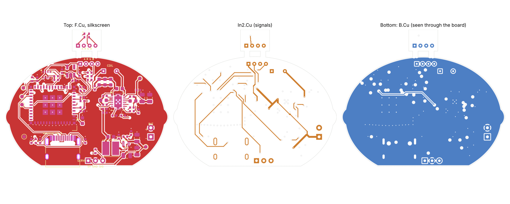

# squeeze main board: netlist (rev A)

Generated from `hardware/tools/parts.py` by `netlist_doc.py`: the board is built from the same data, so this
is what is on the copper. The circuit blocks are explained in [design.md](design.md) section 5. The routed board:

## Parts

| Ref | Part | LCSC | Pins → nets | Notes |
|---|---|---|---|---|
| C1 | 100nF 50V X7R 0603 |  | 1: COIL_A; 2: AC1 | series resonance: 3 x 100n + 10n = 310 nF |
| C2 | 100nF 50V X7R 0603 |  | 1: COIL_A; 2: AC1 |  |
| C3 | 100nF 50V X7R 0603 |  | 1: COIL_A; 2: AC1 |  |
| C4 | 3.3nF 50V C0G 0603 |  | 1: AC1; 2: AC2 | parallel (detection) resonance ~1 MHz |
| C5 | 10nF 50V X7R 0402 |  | 1: AC1; 2: BOOT1 |  |
| C6 | 10nF 50V X7R 0402 |  | 1: AC2; 2: BOOT2 |  |
| C7 | 470nF 25V X7R 0603 |  | 1: AC1; 2: CLAMP1 |  |
| C8 | 470nF 25V X7R 0603 |  | 1: AC2; 2: CLAMP2 |  |
| C9 | 22nF 50V X7R 0402 |  | 1: AC1; 2: COMM1 |  |
| C10 | 22nF 50V X7R 0402 |  | 1: AC2; 2: COMM2 |  |
| C11 | 10uF 25V X5R 0805 |  | 1: RECT; 2: GND |  |
| C12 | 100nF 50V X7R 0402 |  | 1: RECT; 2: GND |  |
| C13 | 1uF 10V X5R 0402 |  | 1: VBAT; 2: GND |  |
| C14 | 1uF 10V X5R 0402 |  | 1: VBAT; 2: GND |  |
| C15 | 1uF 10V X5R 0402 |  | 1: +3V3; 2: GND |  |
| C16 | 10uF 10V X5R 0603 |  | 1: VBAT; 2: GND |  |
| C17 | 22uF 10V X5R 0805 |  | 1: +5V; 2: GND |  |
| C18 | 22uF 10V X5R 0805 |  | 1: +5V; 2: GND |  |
| C19 | 22uF 10V X5R 0805 |  | 1: +5V; 2: GND |  |
| C21 | 10uF 25V X5R 0805 |  | 1: RECT; 2: GND |  |
| C22 | 100nF 16V X7R 0402 |  | 1: VBAT; 2: GND |  |
| C23 | 10nF 50V X7R 0402 |  | 1: COIL_A; 2: AC1 |  |
| C24 | 100nF 16V X7R 0402 |  | 1: VBAT_SENSE; 2: GND |  |
| C25 | 100nF 16V X7R 0402 |  | 1: +3V3; 2: GND |  |
| C30 | 10uF 10V X5R 0603 |  | 1: +3V3; 2: GND |  |
| C31 | 100nF 16V X7R 0402 |  | 1: +3V3; 2: GND |  |
| C32 | 1uF 10V X5R 0402 |  | 1: EN; 2: GND |  |
| D1 | XL-1615RGBC-RF | C965840 | 1: TAB_A; 2: TAB_R; 3: TAB_G; 4: TAB_B | common anode, on the break-off tab |
| J1 | Battery 503030 *(hand)* |  | 1: VBAT; 2: GND | 1S LiPo ~400 mAh with protection PCM: red to 1 (VBAT), black to 2 |
| J2 | Servo SG90 *(hand)* |  | 1: +5V; 2: GND; 3: SERVO_SIG | cut the servo plug off: red to 1, brown to 2, orange to 3 |
| J3 | TYPE-C-31-M-12 | C165948 | A1,A12,B1,B12,S1: GND; A4,A9,B4,B9: VBUS; A5: CC1; A6,B6: USB_DP; A7,B7: USB_DN; A8,B8: —; B5: CC2 | data only: VBUS powers nothing, it is only sensed. Battery must be fitted to flash |
| J4 | LED wires *(hand)* |  | 1: +3V3; 2: LED_RK; 3: LED_GK; 4: LED_BK | 4 thin wires up the chassis post to J5 on the LED tab |
| J5 | LED tab wires *(hand)* |  | 1: TAB_A; 2: TAB_R; 3: TAB_G; 4: TAB_B |  |
| L1 | TDK WR303050-12F5-ID *(hand)* | C6357742 | 1: COIL_A; 2: AC2 | Qi coil on the base floor under the board; its two leads come up through these holes (hand-soldered) |
| L2 | 1uH 4030 shielded | C5291823 | 1: VBAT; 2: SW | CENKER CKCS4030-1uH/N, 4 x 4 x 3 mm |
| R1 | 1.37k 1% 0402 |  | 1: ILIM; 2: FOD | R_ILIM = R1 + R2 = 1.566k -> I_BULK = 314 / 1566 = 200 mA (0.5C for 400 mAh) |
| R2 | 196 1% 0402 |  | 1: FOD; 2: GND | R_FOD, as brim |
| R3 | 10k 1% 0402 |  | 1: TERM; 2: GND | termination ~42 % of I_BULK, as brim |
| R4 | 1M 1% 0402 |  | 1: VBAT; 2: VBAT_SENSE |  |
| R5 | 1M 1% 0402 |  | 1: VBAT_SENSE; 2: GND |  |
| R6 | 4.7k 1% 0402 |  | 1: +3V3; 2: SDA |  |
| R7 | 4.7k 1% 0402 |  | 1: +3V3; 2: SCL |  |
| R8 | 732k 1% 0402 |  | 1: +5V; 2: FB | VOUT = 0.595 V x (1 + 732k/100k) = 4.95 V (TPS61023 datasheet eq. 4) |
| R9 | 100k 1% 0402 |  | 1: FB; 2: GND |  |
| R10 | 100k 1% 0402 |  | 1: SERVO_EN; 2: GND | servo supply off while the ESP32 boots or sleeps |
| R11 | 100 1% 0402 |  | 1: SERVO_PWM; 2: SERVO_SIG |  |
| R12 | 5.1k 1% 0402 |  | 1: CC1; 2: GND |  |
| R13 | 5.1k 1% 0402 |  | 1: CC2; 2: GND |  |
| R14 | 56k 1% 0402 |  | 1: VBUS; 2: VBUS_SENSE | 5 V -> 3.2 V: a clean logic high (ESP32-C3 VIH = 0.75 x 3.3 = 2.48 V), < 3.6 V at 5.25 V |
| R15 | 100k 1% 0402 |  | 1: VBUS_SENSE; 2: GND |  |
| R16 | 220 1% 0402 |  | 1: LED_R; 2: LED_RK |  |
| R17 | 68 1% 0402 |  | 1: LED_G; 2: LED_GK |  |
| R18 | 68 1% 0402 |  | 1: LED_B; 2: LED_BK |  |
| R30 | 10k 1% 0402 |  | 1: +3V3; 2: EN | EN pull-up; with C32 a ~10 ms reset delay |
| R31 | 10k 1% 0402 |  | 1: +3V3; 2: IO2 |  |
| R32 | 10k 1% 0402 |  | 1: +3V3; 2: CHG_N |  |
| TH1 | 10k NTC B3380 | C77131 | 1: NTC; 2: GND | Murata NCP15XH103F03RC: board temperature for the charger's TS input |
| TP1 | BOOT *(hand)* |  | 1: BOOT |  |
| TP2 | TXD *(hand)* |  | 1: TXD |  |
| TP3 | GND *(hand)* |  | 1: GND |  |
| TP5 | +3V3 *(hand)* |  | 1: +3V3 |  |
| TP6 | +5V *(hand)* |  | 1: +5V |  |
| TP7 | RECT *(hand)* |  | 1: RECT |  |
| U1 | ESP32-C3-MINI-1U-N4 | C2911374 | 1,2,11,14,36,37,38,39,40,41,42,43,44,45,46,47,48,49,50,51,52,53: GND; 3: +3V3; 5: IO2; 6: LED_R; 8: EN; 12: VBAT_SENSE; 13: VBUS_SENSE; 16: SERVO_PWM; 18: LE… | External antenna on the module's U.FL: adhesive 2.4 GHz FPC antenna (hand part) |
| U2 | BQ51050BRHLR | C133307 | 1,9,11,20,21: GND; 2: AC1; 3: BOOT1; 4: VBAT; 5: CLAMP1; 6: COMM1; 7: CHG_N; 8: —; 10: TERM; 12: ILIM; 13: NTC; 14: FOD; 15: COMM2; 16: CLAMP2; 17: BOOT2; 18… | AD (9) and EN2 (11) grounded, AD-EN (8) open: as brim |
| U3 | RT9080-33GJ5 | C841192 | 1,3: VBAT; 2: GND; 4: —; 5: +3V3 | 600 mA LDO, 2 uA Iq (as brim) |
| U4 | BMP280 | C83291 | 1,5,7: GND; 2,6,8: +3V3; 3: SDA; 4: SCL | I2C address 0x76 (SDO to GND), CSB high = I2C. Keep its vent hole free of coating |
| U5 | TPS61023DRLR | C919459 | 1: FB; 2: SERVO_EN; 3: VBAT; 4: GND; 5: SW; 6: +5V | EN low: output fully disconnected (0.1 uA), so no load switch is needed |

## Nets

| Net | Connects |
|---|---|
| +3V3 | C15.1 C25.1 C30.1 C31.1 J4.1 R6.1 R7.1 R30.1 R31.1 R32.1 TP5.1 U1.3 U3.5 U4.2 U4.6 U4.8 |
| +5V | C17.1 C18.1 C19.1 J2.1 R8.1 TP6.1 U5.6 |
| AC1 | C1.2 C2.2 C3.2 C4.1 C5.1 C7.1 C9.1 C23.2 U2.2 |
| AC2 | C4.2 C6.1 C8.1 C10.1 L1.2 U2.19 |
| BOOT | TP1.1 U1.23 |
| BOOT1 | C5.2 U2.3 |
| BOOT2 | C6.2 U2.17 |
| CC1 | J3.A5 R12.1 |
| CC2 | J3.B5 R13.1 |
| CHG_N | R32.2 U1.22 U2.7 |
| CLAMP1 | C7.2 U2.5 |
| CLAMP2 | C8.2 U2.16 |
| COIL_A | C1.1 C2.1 C3.1 C23.1 L1.1 |
| COMM1 | C9.2 U2.6 |
| COMM2 | C10.2 U2.15 |
| EN | C32.1 R30.2 U1.8 |
| FB | R8.2 R9.1 U5.1 |
| FOD | R1.2 R2.1 U2.14 |
| GND | C11.2 C12.2 C13.2 C14.2 C15.2 C16.2 C17.2 C18.2 C19.2 C21.2 C22.2 C24.2 C25.2 C30.2 C31.2 C32.2 J1.2 J2.2 J3.A1 J3.A12 J3.B1 J3.B12 J3.S1 R2.2 R3.2 R5.2 R9.2 R10.2 R12.2 R13.2 R15.2 TH1.2 TP3.1 U1.1 U1.2 U1.11 U1.14 U1.36 U1.37 U1.38 U1.39 U1.40 U1.41 U1.42 U1.43 U1.44 U1.45 U1.46 U1.47 U1.48 U1.49 U1.50 U1.51 U1.52 U1.53 U2.1 U2.9 U2.11 U2.20 U2.21 U3.2 U4.1 U4.5 U4.7 U5.4 |
| ILIM | R1.1 U2.12 |
| IO2 | R31.2 U1.5 |
| LED_B | R18.1 U1.19 |
| LED_BK | J4.4 R18.2 |
| LED_G | R17.1 U1.18 |
| LED_GK | J4.3 R17.2 |
| LED_R | R16.1 U1.6 |
| LED_RK | J4.2 R16.2 |
| NTC | TH1.1 U2.13 |
| RECT | C11.1 C12.1 C21.1 TP7.1 U2.18 |
| SCL | R7.2 U1.21 U4.4 |
| SDA | R6.2 U1.20 U4.3 |
| SERVO_EN | R10.1 U1.30 U5.2 |
| SERVO_PWM | R11.1 U1.16 |
| SERVO_SIG | J2.3 R11.2 |
| SW | L2.2 U5.5 |
| TAB_A | D1.1 J5.1 |
| TAB_B | D1.4 J5.4 |
| TAB_G | D1.3 J5.3 |
| TAB_R | D1.2 J5.2 |
| TERM | R3.1 U2.10 |
| TXD | TP2.1 U1.31 |
| USB_DN | J3.A7 J3.B7 U1.26 |
| USB_DP | J3.A6 J3.B6 U1.27 |
| VBAT | C13.1 C14.1 C16.1 C22.1 J1.1 L2.1 R4.1 U2.4 U3.1 U3.3 U5.3 |
| VBAT_SENSE | C24.1 R4.2 R5.1 U1.12 |
| VBUS | J3.A4 J3.A9 J3.B4 J3.B9 R14.1 |
| VBUS_SENSE | R14.2 R15.1 U1.13 |
