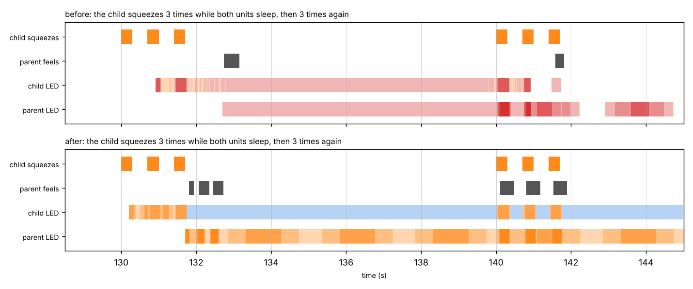

# squeeze: virtual bring-up and usability experiments

Before the boards are ordered, both experiments were run on the real firmware: unmodified, compiled twice
(the parent's and the child's build), in a simulated world with two units and two people. The bench, its models
and its limits are described in [`firmware/sim/README.md`](../firmware/sim/README.md). It runs in seconds:

```
cd squeeze/firmware/sim && make && make before
python3 experiments.py --tag after --sim sim            # this firmware
python3 experiments.py --tag before --sim sim_before    # the firmware as it was before these experiments (git HEAD)
python3 ../../hardware/tools/erc.py                     # static electrical checks
```

**Outcome:** the experiments found **11 real problems**. Ten are fixed in the firmware and re-measured; one,
overlapping squeezes, is inherent to the design and is now documented.

| # | Found | Experiment | Fix |
|---|---|---|---|
| 1 | `bmp280.c` used `false` without `<stdbool.h>` (it would only compile by accident of the ESP-IDF include chain) | first compile | include added |
| 2 | Nothing on the bench says whether the hardware works: no report, servo never exercised | B1 | **self-test** at power-on with USB attached |
| 3 | The LED's perceptual curve squared each channel: the child's orange showed as **red** (the low-battery colour) | B2, U2 | curve on the brightness, not per channel |
| 4 | "Connected" and "charging" were ~0.2 % PWM: **invisible** | B5, smoke test | visible floor; charging is now green |
| 5 | Asleep, the unit sampled pressure once per 2 s: a quick squeeze woke it **7 times in 30** | U4 | 10 Hz sampling in light sleep: **30/30** |
| 6 | After waking by a squeeze, a lagging baseline (the hand warms the air) made a **phantom 10 s squeeze** that swallowed the real ones | U2 trace | baseline from the 10 Hz doze samples, frozen during a rise |
| 7 | Squeezes made while the partner was waking were **lost**, and the 0.4 s "hello" swell was mistaken for a squeeze | U1, U2 | squeezes are **kept and replayed** with their rhythm; hello swell removed |
| 8 | A call nobody answers gave no feedback | U6 | "nobody answered": 3 quick blinks of own colour |
| 9 | The partner's low battery was invisible on the other unit | U7 | short red flash every 4 s |
| 10 | A gentle 3 N squeeze could not wake a dozing unit | U9 | wake threshold 250 → 150 Pa (no false wakes in 1 h, U11) |
| 11 | A squeeze starting ≤ 0.25 s after the partner's is lost | U5 | **inherent** (turn-taking: the plates' own push looks like a squeeze); documented |



*U2 before and after. The child squeezes 3 times while both units sleep, then 3 times more. **Before**, the parent
felt only two things: the hello swell and a phantom squeeze. The LEDs showed red-looking colours. **After**, the parent
felt all six squeezes with their rhythm, the first three replayed ~1–1.8 s late. The child's LED shows calling, then
blue (connected); the parent's LED shows the orange invite.*

---

## 1. Bring-up

### 1a. On paper: `hardware/tools/erc.py` (31 checks on `parts.py`)
**30 pass, 1 warning, 0 fail.** It checks:
- **ESP32 boot:** EN reset delay 10 ms, GPIO2 and GPIO8 strapping pins held high, GPIO9 only on a test pad, USB D+/D− straight to the pins, CC pull-downs present.
- **Pin voltages:** VBUS sense 3.04–3.37 V (above the 2.48 V logic-high threshold, below the 3.6 V maximum); battery sense 2.10 V at 4.2 V (inside the 2.5 V ADC range).
- **Power:** boost output 4.95 V, enable defaults off; charge current 201 mA; NTC and termination resistor present.
- **Parts:** decoupling on every rail; LED currents 5.9 mA each; I2C pull-ups; BMP280 address pin to GND (0x76); hardware standby current 7.2 µA.

The **warning**: below ~3.5 V battery the RT9080 has ~100 mV of headroom, so 3.3 V can sag to ~3.2 V in Wi-Fi
transmit bursts. The ESP32-C3 runs to 3.0 V, and the firmware stops the servo at 3.4 V and deep-sleeps at 3.3 V.

### 1b. Simulated first power-up (`scenarios/bringup_*.txt`)
| Run | Before | After |
|---|---|---|
| **B1** USB attached, nobody holding | Boots, stays awake, LED calling. No report; servo never moved | **Self-test:** `battery 3980 mV: PASS`, `charger CHG: not charging`, `pressure sensor: 101322 Pa: PASS`, LED red/green/blue, servo rest → full → rest then 5 V off, `SELF-TEST PASSED (0 failures)`. Never dozes on USB |
| **B2** BMP280 not answering | Logs the error; still receives (felt 130 ms after the partner's squeeze). LED shows the partner's orange as red | Same, plus `pressure sensor: FAIL (no BMP280 at 0x76: check U4 soldering)`; colours correct |
| **B3** both powered, one squeeze each, then idle | Felt 110 ms (A→B) and 130 ms (B→A) after the squeeze started; boost on during playback, off ~1.2 s later; both sleep 90 s after the last squeeze | Same latencies and power-down; both doze 90 s after the last squeeze |
| **B5** on a Qi pad, charging | LED dark (faint amber at ~0.2 % PWM) | Faint **green** |

The bring-up checklist in [design.md](design.md) section 9 now starts with the self-test and points each `FAIL` at
a part.

---

## 2. Usability

**People:**
- **Parent:** holds their unit, squeezes firmly (20 N), and sends 3 patterns (2 squeezes; short-short-long; long + 3 quick). After a reply, they wait 2 s and send the next pattern.
- **Child:** copies what it felt, with the same count and ±20 % durations and gaps, at 8 N, 0.6–1.2 s after the pattern ends.

Unless stated otherwise, both units start dozing, as at bedtime.

| Run | What it tests | Before | After |
|---|---|---|---|
| **U1** the game (5 seeds) | 3 rounds from sleep | parent→child **6/9** felt, child→parent **4/6**, 2 of 3 rounds completed | **9/9 and 9/9, 3/3 rounds**, every seed; median 110–130 ms |
| **U2** the child starts, both asleep | 3 squeezes, then 3 more 10 s later | **2/6** felt (one was really the hello swell) | **6/6**: first three replayed 1.8 / 1.4 / 1.0 s late, then 105–125 ms |
| **U3** parent's unit on the table | Child calls; parent picks up 25 s later | Child's squeezes never woke its own unit (2 s sampling): nothing happened until pick-up; reply 665 ms | Parent's unit **glows the child's orange** from the call until picked up; reply felt in **120 ms** |
| **U4** a quick squeeze (0.25 s) while asleep, 30 random times | Wake reliability | **7/30** woke | **30/30** |
| **U5** both squeeze 0.1 s / 0.25 s apart | Overlap | Parent's felt 2/2; child's **0/2** | Same: **inherent** to turn-taking |
| **U6** child out of range | Feedback | Red-looking breathing, then dark | Own colour breathing (calling), then **3 quick blinks**: nobody answered |
| **U7** child's battery at 5 % | Low battery | Child's unit blinks red; parent's unit shows nothing | Child's unit blinks red; **parent's unit flashes red every 4 s** |
| **U9** gentle squeezes 2–10 N (80 Pa/N) | Detection, asleep / awake | Asleep: only the hello swell counted; awake: missed up to 8 N (the phantom squeeze) | **All delivered from 2 N up**, asleep and awake |
| **U10** a 6 s hug squeeze | Hold limit | Plates relax after 4.07 s | Same (servo protection, by design) |
| **U11** held for 1 h, nobody squeezing | False wake-ups at the lower threshold | 0 calls | **0 calls** |
| **U8** battery | Standby / play | 2.58 mA dozing; 9.4 mAh per 5-min session; **4.4 days** at 3 sessions/day | **2.76 mA** dozing (10 Hz sampling); 10.1 mAh per session; **4.1 days**. With `SLEEP_PERIOD_MS = 3000`: 2.06 mA, 5.0 days, but one of nine child squeezes lost in 2 of 5 game runs, so the default stays at 2 s |

---

## 3. Limits of a virtual experiment

- **The ESP-IDF calls are stand-ins.** They copy the real names and signatures (ESP-IDF 5.3), so the firmware
  compiles and its logic runs, but they are not the real drivers. Still to verify on hardware:
  - the light sleep ↔ `esp_wifi_stop/start` ↔ `esp_now_deinit/init` sequence and its timing (modelled at 35 ms);
  - the light-sleep current (modelled at 130 µA);
  - the BMP280 forced-x1 timing (datasheet 5.5 ms typical, 6.4 ms maximum).
- **The physics is modelled, not measured:**
  - squeeze pressure 80 Pa per newton (sized to the CAD's 0.6–2.2 kPa);
  - plate push into a held hand 250 Pa/mm, felt at 4 N/mm, felt above 1 N;
  - warming air +0.34 kPa/°C;
  - servo speed 600°/s;
  - current figures per state.

  Bring-up step 5 of design.md section 9 measures the real squeeze pressure; retune `WAKE_PA` and `on_pa` with it.
- **The people are simple.** They squeeze with clean ramps and never shake, drop, or play with the unit. A real
  6-year-old will. Picking a unit up with a firm grip will wake it and call the partner, by design.
- **Deep sleep** (now used only at a flat battery) keeps RAM in the simulator. On the chip only `RTC_DATA_ATTR`
  survives it. The firmware no longer relies on anything else across a deep sleep.
